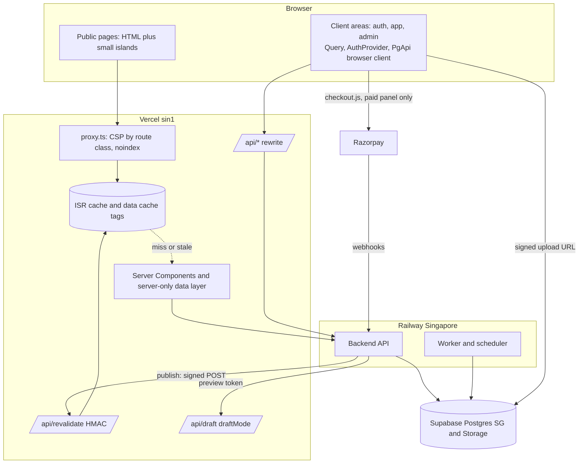

# Architecture: Web Frontend (Next.js App Router, mock-first)

**ID:** ARCH-001
**Type:** architecture
**Feature:** FEAT-001 (`docs/requirements/FEAT-001-frontend-rewrite.md`)
**Plan:** PLAN-001, TASK-002
**Version:** 3
**Status:** draft (pending owner review; no agent may approve)
**Date:** 2026-10-22
**Author:** architect

How to read this: sections 5 to 12 hold the load-bearing decisions (stack, rendering, revalidation, CSP, data layer, auth). Sections 13 to 19 are cross-cutting standards. Section 26 is the decision register, section 30 lists what the planner must change, section 31 lists FEAT-001 follow-up edits, and Appendix A is ready-to-copy rule text for TASK-003. Versions were queried from npm on 2026-10-21. Next.js behaviour was checked against the docs bundled in `next@16.4.2`; static output and baseline bundle size were checked with a throwaway spike built outside the repo (not kept).


## 0. Approval record and scope
### 0.1 Owner approval of FEAT-001 defaults

The project owner approved the FEAT-001 defaults on **2026-10-21**. FEAT-001 is treated as approved on that basis. ARCH-001 builds on these decisions and does not reopen them.

| FEAT-001 item | Approved value | Used in |
|---|---|---|
| OQ-01 | Story detail page at `/stories/[slug]` (prerendered, in sitemap, simple structured blocks) | 7, 8, 9 |
| OQ-02 | Results flow: either player submits, opponent or host confirms, admin resolves; UI follows server capability flags | 11, 20 |
| OQ-03 | Draft preview: Next `draftMode` in real mode, mock-only route in mock mode; always `noindex`, never publicly cached | 8.4 |
| OQ-05 | Browser floor: last two versions of Chrome, Edge, Firefox, Safari; iOS Safari 16.4+; Chrome Android 111+ | 5, 16 |
| OQ-09 | Rematch, member/comp/donation pricing, WhatsApp/SMS and waivers hidden at launch | 20 |
| OQ-11 | LCP 2.5 s, CLS 0.1, TBT 200 ms, Lighthouse 90; publish-to-visible 60 s (real backend); 15-minute safety-net revalidation | 9, 14 |
| A-07 / AC-115 | Money: whole rupees without decimals, two decimals otherwise, "Free" for zero, Indian digit grouping | 13.9 |

All other FEAT-001 open questions use their proposed defaults (OQ-04, 06, 07, 08, 10, 12 to 18). Consequences that matter here: OQ-06 means signed-in and admin routes use the event UUID (`/app/events/[id]`, `/admin/events/[id]`) while public routes use slugs; OQ-07 means the builder is reused at `/admin/events/[id]/edit`; OQ-08 means a cancelled event keeps its URL with a notice and `EventCancelled` JSON-LD and leaves the Play list; OQ-10 means no analytics script (an adapter exists, section 19); OQ-14 means published media is public-read and drafts use signed URLs.

### 0.2 Scope

In scope: the architecture of `web/`, its contract with a future backend (`PgApi`, envelope, revalidation webhook, preview, availability) and the conventions every frontend task follows. Out of scope: backend implementation, the database move (TASK-117) and the detailed hosting note (TASK-115), which follows the topology recorded in section 18.

### 0.3 Constraints inherited, not reopened

Next.js App Router, React 19, TypeScript strict, Tailwind v4 CSS-first tokens, TanStack Query in client areas only, react-hook-form with zod (FEAT-001 C-01). `react-best-practices` (RBP) governs React code (C-02). Hosting is Vercel `sin1`, Railway Singapore, Supabase Singapore (D-05). Media is in Supabase Storage (D-06). The server owns price, capacity, holds, payment state, roles and slug uniqueness (C-09). All responses use the unified envelope (C-10).


## 1. Context
PG Chess needs a new website: a mobile-first public site that search engines and link previews can read, a registration and payment flow, an Event Room used on a phone at a physical event on poor networks, and an admin Control Room. The design exists as 58 static reference screens plus documents. The backend does not exist yet and is being rebuilt separately, so the frontend must be buildable, demonstrable and testable against a typed contract with mocks, and that contract becomes the specification the backend is built to.

Forces that shape the design:

1. **Prerendering is mandatory** for public pages, yet content changes on admin publish and must appear within 60 seconds with the real backend.
2. **Two different workloads in one app.** Public pages are read-mostly, cacheable and SEO-critical. Signed-in areas are per-user, token-authenticated in the browser, and interaction-heavy.
3. **A security tension.** The refresh token lives in browser storage (owner-accepted), so XSS is the main threat, which argues for the strictest CSP. A nonce-based CSP forces per-request rendering (stated in the Next.js docs), which defeats prerendering. Section 10 resolves this.
4. **A contract that does not exist yet.** The legacy Django API does not implement the unified envelope, so the client must accept both shapes while the new backend is built.
5. **Mobile and accessibility are first-class** (320 and 390 widths, 44 to 48 px targets, WCAG 2.2 AA) and performance is measured per route.
6. **Scale.** 117 tasks run in parallel across many engineers and agents, so conventions must be mechanical and lint-enforceable.


## 2. Current state
- `web/` does not exist yet.
- The repository root holds the legacy Vite SPA (`src/`, `vite.config.js`, root `package.json`, root `vercel.json` with a catch-all rewrite) and the legacy Django `backend/`. They stay untouched until the gated cutover (TASK-107). `web/` is an independent package, not a workspace member.
- `.claude/rules/40-frontend.mdc` still describes Expo. TASK-003 reconciles it using Appendix A.
- Reference material is in `Frontend reference/`. Its docs describe a Vite and Supabase mechanism that is design intent only (FEAT-001 C-11).
- The unified envelope decision exists (`docs/decisions/2026-09-15-unified-api-response-envelope.md`) but the legacy backend does not implement it for existing endpoints.
- Registry state on 2026-10-21: next 16.4.2, react 19.3.1, tailwindcss 4.3.3, @tanstack/react-query 5.104.5, react-hook-form 7.90.0, @hookform/resolvers 6.0.0, zod 4.6.7, vitest 5.0.5, @playwright/test 1.64.1, eslint 10.13.0, typescript 7.0.2. Local toolchain: Node 24.19, npm 12.
- Empirical baseline from a throwaway spike (Next 16.4.2, Turbopack, an empty static page plus one client island, built outside the repo): module-script First Load JS about 456 KB uncompressed and **about 137 KB gzip** before any application code. A prerendered page contained three inline `<script>` elements (runtime bootstrap, `self.__next_f` init, RSC flight payload) and no inline `<style>`. With `experimental.sri` enabled the external scripts gained `integrity` attributes but the three inline scripts remained.


## 3. Proposed solution
**One Next.js 16 App Router app in `web/`, one root layout, five route groups split by rendering contract.**

1. **`(public)`**: Server Components, statically prerendered with ISR. Data comes from a `server-only` public data layer whose fetches carry cache tags and a 15-minute safety-net `revalidate`. A backend publish calls an HMAC-signed `POST /api/revalidate` that expires the right tags. Volatile data (places left, registration state) is never baked into HTML; a small client island fetches it live. Drafts preview through `draftMode`.
2. **`(auth)`, `(app)`, `(admin)`**: server-rendered shells that fetch no data, wrapped in client providers (TanStack Query, auth context, toasts). All data is fetched in the browser through the typed `PgApi` browser client. Every response is `noindex`. Because these groups are not prerendered they can carry a per-request nonce CSP.
3. **`(handoff)`**: developer-only design-system and states pages, absent from production builds.
4. **Data contract.** One `PgApi` TypeScript interface (zod-validated DTOs, integer paise, slugs) is the only way components obtain data. Adapters: mock (works in server rendering and the browser, no per-request mutable state) and real (fetch, envelope plus legacy-bare normaliser). `NEXT_PUBLIC_USE_MOCKS` selects the adapter and dead-code-eliminates the other.
5. **CSP.** Decided in one file (`proxy.ts`), split by route class (section 10). Public prerendered pages get a static CSP with `script-src 'self' 'unsafe-inline'`, no `unsafe-eval`, `object-src 'none'`, `base-uri 'self'`, `frame-ancestors 'none'` and host allow-lists. The client groups get a strict nonce plus `strict-dynamic` CSP. The strictest policy therefore sits exactly where tokens live, and prerendering is preserved.
6. **Auth.** Access token in memory, refresh token in versioned `localStorage`, single-flight refresh coordinated across tabs, guards are UX only (section 12).
7. **One origin.** The browser calls `/api/*`, which Vercel rewrites to Railway, so there is no CORS. Local route handlers (`/api/revalidate`, `/api/draft`) take precedence over an `afterFiles` rewrite.
8. **No Server Actions** (DEC-014). Writes go from the browser to the backend with the user's token. Server Actions would add a second authentication surface for no benefit.
9. **Previous caching model, not Cache Components** (DEC-003): `fetch` tags, route `revalidate`, `generateStaticParams`. The public data layer is the only place that changes if `use cache` is adopted later.




## 4. Components
| ID | Name | Responsibility | Changes |
|----|------|----------------|---------|
| COMP-001 | App shell and route groups (`web/src/app`) | Root layout, five route groups, boundaries (`loading`, `error`, `not-found`), skip link, `noindex` for non-public groups | New |
| COMP-002 | Edge policy (`web/src/proxy.ts`, `next.config.ts` headers) | CSP by route class, security headers, `X-Robots-Tag`, nonce for client groups; never intercepts `/api/*` | New |
| COMP-003 | Public data layer (`web/src/lib/data/public`) | `server-only` cached fetchers with tags, `React.cache` dedup, minimal DTOs | New |
| COMP-004 | PgApi contract (`web/src/lib/api/types`, `pg-api.ts`) | Interface, zod schemas, error codes; the specification for the backend | New |
| COMP-005 | API transport (`web/src/lib/api/{http,envelope,errors,error-copy}`, `server/`, `browser/`) | Envelope and legacy-bare normaliser, ApiError, copy map, server fetch, browser client with single-flight refresh | New |
| COMP-006 | Mock adapter (`web/src/lib/mock`) | Server-safe immutable seeds; per-session client store for mutable state; scenario switcher | New |
| COMP-007 | Query layer (`web/src/lib/query`) | QueryClient provider, key factory, `queryOptions`, mutation helper, visibility-aware polling | New |
| COMP-008 | Auth (`web/src/features/auth`) | AuthProvider, token store, guards, return-to, cross-tab sign-out | New |
| COMP-009 | Revalidation endpoint (`web/src/app/api/revalidate`) | HMAC verify, replay window, tag mapping, 202 | New |
| COMP-010 | Draft preview (`web/src/app/api/draft`, `/handoff/preview`) | Enable draftMode from a backend-issued token; mock-only preview route | New |
| COMP-011 | SEO layer (`web/src/lib/seo`, `sitemap.ts`, `robots.ts`, `opengraph-image`) | Metadata helpers, Event JSON-LD, sitemap, robots | New |
| COMP-012 | Design system (`web/src/components/ui`, `domain`, `layout`) | Tokens, primitives, icons (one module each), domain components, shells | New |
| COMP-013 | Feature modules (`web/src/features/*`) | registration, event-room, event-builder, event-control, cms, media, rating, profile | New |
| COMP-014 | Observability adapter (`web/src/lib/observe`) | Error reporting, web-vitals, analytics events behind an adapter; PII scrubbing | New |
| COMP-015 | Test harness (`web/e2e`, `web/src/test`) | Vitest, Testing Library, vitest-axe, Playwright projects, contract conformance suite | New |
| COMP-016 | Contract export (`web/scripts/export-contract.ts`) | Generates `docs/architecture/pgapi-contract/` from zod schemas | New |
| COMP-017 | Legacy app (`src/`, root Vite config) | Untouched until TASK-107 | Unchanged |


## 5. Stack and versions
### 5.1 Versions and tooling

Versions are pinned through `package-lock.json` (npm `ci` in CI and on Vercel); `package.json` uses `~` ranges for Next, React, Tailwind and TanStack Query so a minor bump is a deliberate change. TASK-007 re-verifies every row against the registry and records the result.

| Area | Choice | Installed | Notes |
|---|---|---|---|
| Framework | **Next.js 16.4.x**, App Router, Turbopack (default in 16) | 16.4.2 | Node 20.9+ and TypeScript 5.1+ are the minimums. Browser floor of Next 16 (Chrome/Edge/Firefox 111+, Safari 16.4+) equals the Tailwind v4 floor and the FEAT-001 floor. |
| UI runtime | **React 19.3.x** | 19.3.1 | `ref` as a prop, `use`, `useTransition`, `useDeferredValue`, `Activity` available. |
| Language | **TypeScript 5.9.x**, `strict`, `noUncheckedIndexedAccess`, `exactOptionalPropertyTypes` off, `verbatimModuleSyntax` | 5.9.3 | Registry latest is 7.0.2 but `typescript-eslint` declares peer `<6.1.0`; stay on 5.9 until the lint stack supports 6 or 7 (DEC-002). |
| Styling | **Tailwind CSS 4.3.x** via `@tailwindcss/postcss`, CSS-first `@theme` | 4.3.3 | No `tailwind.config.js`. Prettier plugin for class order. |
| Server state, client areas | **@tanstack/react-query 5.x** | (later) | Mounted only in the three client groups, never in `(public)`. |
| Forms | **react-hook-form 7.x** with **zod 4.x** and `@hookform/resolvers` | zod 4.6.7 | TASK-007 verifies the resolver major that supports zod 4. zod schemas are shared with `PgApi` DTOs. |
| UI primitives | **Radix per-package imports** (P1): `@radix-ui/react-dialog` (Dialog, Drawer, Sheet), `react-tabs` (local tabs only), `react-switch` | (later) | Route-linked tabs are real `<Link>`s, not Radix. Native `<select>`, `<input type=date/time>` for 16px/touch correctness. No unified `radix-ui` package (barrel). |
| Icons | In-house SVG modules, one file per icon, no package | (later) | Section 13.5. |
| HTTP | `fetch` only | (built-in) | No axios. |
| Lint | **ESLint 9.x flat config**, `eslint-config-next`, `typescript-eslint`, `eslint-plugin-jsx-a11y`, `react-hooks` | 9.39.5 | Registry latest is 10.13.0; `eslint-config-next` accepts 10, but each plugin must declare support; stay on 9 until the stack supports 10 (DEC-002); TASK-008 decides. |
| Architecture lint | **dependency-cruiser** (`npm run check:deps`) | Enforces group isolation, `server-only` and client boundaries, no cycles; ESLint cannot express these cleanly. |
| Format | Prettier + `prettier-plugin-tailwindcss` | |
| Unit and component tests | **Vitest 5**, `@testing-library/react`, `user-event`, jsdom, axe via a thin `expectNoAxeViolations` helper over `vitest-axe` | `vitest-axe` is pre-1.0; the helper isolates it so it can be swapped for raw `axe-core` without touching tests. |
| E2E | **@playwright/test 1.64**, `@axe-core/playwright`, Chromium and WebKit (Firefox on the nightly project) | Section 16. |
| Contract tests against the real adapter | MSW **in tests only** (P2) | Never in the product build. |
| Bundle analysis | `@next/bundle-analyzer` behind `ANALYZE=true`, plus a size-check script reading `.next/diagnostics/route-bundle-stats.json` | 16.4.2 | Section 14. |
| Type definitions | `@types/node` matching Node version | 24.19.2 | Registry latest is 26.x; use 24.x to match Node 24. |
| Package manager | **npm** (lockfile v3, `npm ci`) | The repo already uses npm and a root `package-lock.json`; Vercel and CI need no extra tooling. pnpm's disk and strictness benefits do not justify a second tool for one app (DEC-002). `web/` has its own `package.json` and lockfile. |
| Node | **Node 24 LTS** (`.nvmrc` = 24, `engines.node` = `>=22.12 <25`, Vercel project Node 24.x) | Matches the developer machine (24.19). TASK-007 confirms Vercel's Node 24 setting and falls back to 22 LTS if unavailable. |
| React Compiler | **Not enabled at launch** (DEC-016) | RBP memo and derived-state rules are applied by hand and audited in TASK-110. Revisit after TASK-110 with measured re-render evidence; enabling is a one-line config change. |
| Cache Components | **Not enabled** (DEC-003) | Section 7.4. |
| Server Actions | **None** (DEC-014) | Section 12.6. |

### 5.2 Browser floor (FEAT-001 OQ-05, approved)

Last two versions of Chrome, Edge, Firefox and Safari, plus iOS Safari 16.4+ and Chrome Android 111+. Older browsers receive readable public HTML (it is server-rendered) without styling guarantees. Tailwind v4 relies on `@property`, `color-mix()` and cascade layers, which is the origin of the 16.4 and 111 floors. Implications:

- `package.json` `browserslist` is set to exactly this floor so SWC/Lightning CSS targets match: `["last 2 Chrome versions", "last 2 Edge versions", "last 2 Firefox versions", "last 2 Safari versions", "iOS >= 16.4", "ChromeAndroid >= 111"]`.
- No polyfills are added. `Array.prototype.toSorted` (Safari 16, Chrome 110) is in the floor and is allowed (RBP `js-tosorted-immutable`); `Array.prototype.findLast`, `structuredClone` are also in. `Intl.DurationFormat`, `Promise.withResolvers` (Safari 17.4, Chrome 119) and `Array.fromAsync` are **banned** by lint until the floor moves.
- Web Locks (Safari 15.4+), `BroadcastChannel` (15.4+), `AbortSignal.any` (Safari 17.4, Chrome 116) are **not** all in the floor. `AbortSignal.any` is therefore not used directly; `lib/api/http.ts` ships a 10-line combiner (TASK-014 note updated, section 30). Web Locks with a `localStorage` fallback is used for refresh coordination (section 12.4).
- `content-visibility: auto` degrades to normal rendering where unsupported (Safari 18+ supports it); this is acceptable because it is only an optimisation.
- Playwright runs WebKit on every PR, Chromium everywhere, Firefox nightly. A physical iOS check stays manual (AC-72, AC-73).


## 6. Repository layout, aliases and module rules
### 6.1 Folder structure

`web/` is an independent package. `src/` holds all application code; configuration sits at the `web/` root.

```
web/
  package.json  package-lock.json  .nvmrc  .env.example
  next.config.ts            # images, rewrites, typedRoutes, security headers (non-CSP), analyzer
  postcss.config.mjs  tsconfig.json  eslint.config.mjs  .dependency-cruiser.cjs
  vitest.config.ts  playwright.config.ts
  public/                   # placeholders/, favicon set, no third-party assets
  scripts/                  # check-tokens.ts, check-bundle-size.ts, guard-env.ts, export-contract.ts, check-build-output.ts
  e2e/                      # Playwright specs, helpers/, fixtures
  src/
    proxy.ts                # CSP by route class, noindex, nonce (client groups only)
    app/
      layout.tsx            # root: <html lang="en">, fonts, globals.css, skip link; reads no cookies/headers
      globals.css           # imports styles/*.css
      not-found.tsx  global-error.tsx
      sitemap.ts  robots.ts  opengraph-image.tsx  icon.svg  apple-icon.png
      (public)/             # prerendered Server Components
        layout.tsx          # PublicNav + Footer, no auth/data reads except site chrome
        page.tsx            # /
        play/  past-events/  community/  contact/  privacy/  terms/  refund-policy/
        events/[slug]/page.tsx
        stories/page.tsx    stories/[slug]/page.tsx
      (auth)/               # client-rendered, dynamic (nonce CSP), noindex
        layout.tsx          # providers: Query, Auth, Toast
        login/  auth/callback/  reset-password/  welcome/
        events/[slug]/register/page.tsx
      (app)/app/            # layout: providers + PlayerShell + RequireAuth
        page.tsx  events/page.tsx  events/[id]/page.tsx  rating/  profile/
      (admin)/admin/        # layout: providers + AdminShell + RequireRole('admin')
        page.tsx  content/  media/  stories/  testimonials/  events/  events/new/  events/[id]/[tab]/  events/[id]/edit/  players/  payments/  settings/
      (handoff)/handoff/    # dev only; layout calls notFound() unless mocks or preview
      api/revalidate/route.ts   api/draft/route.ts   api/draft/exit/route.ts
    components/
      ui/                   # primitives, one component per file; ui/icons/*.tsx one icon per file; ui/form/*, ui/feedback/*, ui/overlay/*
      domain/               # EventCard, EventFacts, BoardCard, RatingPoolCard, ResultRow, Timeline, MetricTile
      layout/               # PublicNav, Footer, PlayerShell, AdminShell, MobileMenu, SkipLink
      dev/                  # ScenarioPanel, MockBanner (mock builds only)
    features/               # client-heavy vertical slices; each may import components/, lib/; never another feature
      auth/  registration/  event-room/  rating/  profile/
      event-builder/  event-control/  cms/  media/  stories-admin/  testimonials-admin/  admin-dashboard/  players-admin/  payments-admin/  settings-admin/
    lib/
      env/        env.server.ts  env.public.ts
      api/        pg-api.ts  types/  envelope.ts  errors.ts  error-copy.ts  http.ts  idempotency.ts
                  server/fetch.ts  browser/client.ts  browser/tokens.ts  browser/session-lock.ts
                  adapters/real.ts  adapters/index.server.ts  adapters/index.browser.ts
      data/public/  getSiteContent.ts  getUpcomingEvents.ts  getEventBySlug.ts  ...  (each starts with import 'server-only')
      mock/       seeds/ (immutable)  scenario.ts  store.browser.ts  adapter.ts  latency.ts
      query/      provider.tsx  keys.ts  query-options/  mutation.ts  polling.ts
      seo/        metadata.ts  jsonld.ts  site.ts
      revalidate/ verify.ts  map.ts  schema.ts
      format/     date.ts  money.ts  rating.ts  (no directive; server and client safe)
      hooks/      useMediaQuery.ts  useReducedMotion.ts  useOnlineStatus.ts  useLiveAnnouncer.ts
      forms/      useZodForm.ts  error-summary.ts
      storage/    versioned.ts
      observe/    report.ts  vitals.ts  scrub.ts  events.ts
      security/   safe-redirect.ts  json-ld-escape.ts  csp.ts
    styles/       theme.css  base.css  utilities.css
    test/         setup.ts  render.tsx  axe.ts
```

### 6.2 Module rules (mechanical, enforced by ESLint and dependency-cruiser)

| # | Rule | Enforced by |
|---|---|---|
| M1 | Alias `@/*` maps to `src/*`. It is the **only** alias. Relative imports are allowed only within the same folder or one level up inside a feature (`./x`, `../x`); cross-folder imports use `@/`. | tsconfig; ESLint `no-restricted-imports` |
| M2 | **No barrel files.** No `index.ts` that re-exports. Import the module that defines the symbol. Icons are imported by path (`@/components/ui/icons/ArrowRight`). There are no documented exceptions. | ESLint `no-restricted-imports` on `**/index`, custom rule banning `export * from` and `export { x } from` outside `*.d.ts`; third-party barrels listed in the ban list (see Appendix A) |
| M3 | `(public)` code may import `components/ui`, `components/domain`, `components/layout/{PublicNav,Footer}`, `lib/*`; it may **not** import `features/*`, `lib/query`, `lib/mock/store.browser`, or Radix overlay code outside the mobile menu island. | dependency-cruiser |
| M4 | A `features/<a>` module may not import `features/<b>`. Shared code moves to `components/` or `lib/`. | dependency-cruiser |
| M5 | `app/(group)` files import only from their own group, `components/`, `features/` (client groups only) and `lib/`. No group imports another group's folders. | dependency-cruiser |
| M6 | Modules under `lib/data/public/`, `lib/api/server/`, `lib/env/env.server.ts`, `lib/revalidate/` start with `import 'server-only'`. Modules under `lib/api/browser/`, `lib/query/`, `lib/mock/store.browser.ts`, `features/*` start with `'use client'` or are imported only by one. A `'use client'` module may not import a `server-only` module (build error from the `server-only` package; also dependency-cruiser). | `server-only`, dependency-cruiser |
| M7 | Components and pages never call `fetch` and never import `lib/mock/*`, `lib/api/adapters/*`. They obtain `PgApi` from `getPublicApi()` (server) or `useApi()` (browser). | ESLint `no-restricted-globals: fetch` in `components/` and `features/`, `no-restricted-imports` |
| M8 | One component per file; file name equals the exported component; default exports only for `page`, `layout`, `route`, `loading`, `error`, `not-found` and config files. | ESLint `import/no-default-export` with an override |
| M9 | Server Components are the default. A file gets `'use client'` only if it uses state, effects, refs, event handlers or browser APIs. `'use client'` files are leaf islands; they receive primitives or small DTOs and `children`. | ESLint custom rule plus review checklist |
| M10 | No `dangerouslySetInnerHTML` except in `lib/seo/JsonLd.tsx`, which accepts only an object and serialises through `lib/security/json-ld-escape.ts`. | ESLint `react/no-danger` with an override for that file |
| M11 | Tokens only: no raw hex or `rgb()`, no arbitrary spacing or colour values (`p-[13px]`, `bg-[#fff]`) in components. | `scripts/check-tokens.ts` in `npm run check` |
| M12 | Statically analysable dynamic imports only: `dynamic(() => import('./Impl'))` with a literal path (RBP `bundle-analyzable-paths`). | ESLint `no-restricted-syntax` on non-literal `import()` |
| M13 | Route params (slug, id) validated against their schema before any fetch or tag operation; slugs must match `^[a-z0-9]+(?:-[a-z0-9]+)*$` max 100 chars (F-08); `notFound()` on mismatch. DTOs and zod schemas enforce the same rule. | ESLint in `app/` and `lib/data`, dependency-cruiser checks `serverGet` calls in `(public)` |

### 6.3 Scripts (`web/package.json`)

`dev`, `build`, `start`, `typecheck`, `lint`, `check:deps`, `check:tokens`, `test`, `test:e2e`, `check` (= typecheck + lint + check:deps + check:tokens + test), `analyze` (= `ANALYZE=true next build --webpack`), `check:bundle` (budget), `check:build-output` (route modes, noindex, no mock code), `export:contract`.

**Build guard and chain:** With `.npmrc` `ignore-scripts=true`, npm does not run `prebuild` or `postbuild` lifecycle scripts (verified on npm 12). The `build` script chains guards explicitly: `build` is `npm run guard:env && next build && npm run check:build-output`. `guard:env` runs `scripts/guard-env.ts`, which fails the build when `VERCEL_ENV=production` and `NEXT_PUBLIC_USE_MOCKS=true`, or when a `NEXT_PUBLIC_*` variable name matches `/SECRET|TOKEN|KEY|PASSWORD/i`. `next.config.ts` also calls `assertBuildEnv` at load so a bare `next build` is covered. A CI check asserts that builds are chained this way (do not invoke `next build` directly).

**Analyze script:** `@next/bundle-analyzer` is a no-op under Turbopack (the Next 16 default). `npm run analyze` builds with `--webpack` to emit the HTML report. Budget numbers always come from the Turbopack build, not from the webpack report; `npx next analyze --output` is the Turbopack-native alternative to evaluate in TASK-099.


## 7. Rendering strategy per route group
### 7.1 Matrix

| Group | Routes | Render mode | Data | Cache and revalidation | Indexing | CSP class |
|---|---|---|---|---|---|---|
| `(public)` | `/`, `/play`, `/past-events`, `/community`, `/stories`, `/contact`, `/privacy`, `/terms`, `/refund-policy` | Static (ISR) Server Components | `lib/data/public/*` via `serverGet` | Tags per section 9.3, `revalidate = 900`, on-demand by webhook | index, in sitemap | `public` |
| `(public)` | `/events/[slug]`, `/stories/[slug]` | ISR: `generateStaticParams` (upcoming plus latest 50 completed; stories: all published, capped 100), `dynamicParams = true` | same | `event:{slug}` / `story:{slug}` plus list tags | index, in sitemap; unknown, draft, unpublished slug returns a real 404 | `public` |
| `(public)` islands | availability on event detail, filter and search on Play, mobile menu, auth-aware nav link, contact form | Client components inside static pages | `useQuery`-free: a tiny `fetch` hook for availability (section 11.6); no Query provider in `(public)` | availability not cached by the CDN (`Cache-Control: no-store` from the backend, request-time) | n/a | `public` |
| `(auth)` | `/login`, `/auth/callback`, `/reset-password`, `/welcome`, `/events/[slug]/register` | Dynamic shell (layout sets `dynamic = 'force-dynamic'`), client data | `PgApi` browser client | none | `noindex` meta plus `X-Robots-Tag` | `client` (nonce) |
| `(app)` | `/app`, `/app/events`, `/app/events/[id]`, `/app/rating`, `/app/profile` | same | same | none | `noindex` | `client` |
| `(admin)` | `/admin/**` | same | same | none | `noindex` | `client` |
| `(handoff)` | `/handoff/**` | Dynamic, `notFound()` unless `NEXT_PUBLIC_USE_MOCKS` or preview opt-in | mock | none | `noindex` | `client` |
| route handlers | `/api/revalidate`, `/api/draft`, `/api/draft/exit` | Node runtime | n/a | never cached | not pages | n/a (JSON/redirect) |
| metadata files | `/sitemap.xml`, `/robots.txt`, `opengraph-image` | Static with ISR (`revalidate = 900`, tag `sitemap`) | public data layer | tag `sitemap` | n/a | n/a |

### 7.2 Why client groups are dynamic shells

A page with no request-time API is prerendered at build time and cannot carry a per-request nonce (stated in the Next.js CSP guide). The three client groups need a nonce CSP (section 10), so each client group layout exports `dynamic = 'force-dynamic'`. The shell renders on the server per hard load (small HTML: providers, shell chrome, a skeleton) and all data is then fetched in the browser. Soft navigations inside the group are RSC fetches of the same small shell. Cost: one Node function invocation per hard load of a signed-in route on Vercel `sin1`; this is a small, bounded price for a nonce CSP exactly where tokens live.

The root layout stays static-compatible: it reads no `cookies()`, `headers()` or `searchParams`, so `(public)` keeps prerendering. The nonce is applied by Next automatically from the request CSP header; no code reads `x-nonce` unless a `<Script>` is added (only the Razorpay loader, which creates its element dynamically and relies on `strict-dynamic`).

### 7.3 Public page rules (DoD-P, mechanised)

1. No `cookies()`, `headers()`, `connection()`, `searchParams`, `unstable_noStore` in `(public)` server code. A lint rule bans these imports under `app/(public)` and `lib/data/public` except in `lib/data/public/preview.ts` (section 8.4). `check:build-output` fails if any `(public)` route is not static or SSG in the build manifest.
2. Page-level `export const revalidate = 900` (a literal, because segment config must be statically analysable) plus per-fetch `next: { tags, revalidate: 900 }`.
3. `notFound()` is called before any `await` of a Suspense-wrapped child, so unknown slugs return a real HTTP 404 (Next only changes the status before streaming begins).
4. Volatile data is a client island with reserved space; the cached HTML shows "Places left: checking" style neutral text, never a stale number presented as live (AC-19).
5. Every page exports `generateMetadata` (or static `metadata`) through `lib/seo/metadata.ts`.
6. Raw-HTML test (JavaScript disabled) is part of each public route's definition of done.

### 7.4 Caching model: previous model, not Cache Components

Next 16 offers Cache Components (`'use cache'`, Partial Prerendering). It is **not** enabled (DEC-003): the public site is page-granular ISR, the tag and `revalidate` model is stable and documented, ISR with `generateStaticParams` maps directly to the product need, and Cache Components changes defaults for every route (dynamic by default, `instant` validation) in a project with 117 tasks and many hands. All caching is isolated in `lib/data/public`, so a later move to `'use cache'` plus `cacheTag` touches one folder. Revisit when there is a measured need for partial prerendering (for example personalised sections on public pages).

### 7.5 Streaming and Suspense

- Public pages are fully static, so streaming does not apply at runtime; Suspense boundaries still matter at **build time** only for islands that are client-only.
- Client groups stream their shell immediately (`loading.tsx` renders the group skeleton). Page content is client-fetched; each independent section owns its own `useQuery` and skeleton so one slow or failed section never blanks the page (AC-40).
- Server-rendered secondary data does not exist in the client groups, so `async-suspense-boundaries` applies to the public fetchers only where one page composes multiple independent fetches (Home): the fetches start together (`Promise.all` in the page or sibling async components) and are all awaited before the shell is cached.

### 7.6 Build-time dependency on the backend

`next build` prerenders `(public)` and calls the backend (or the mock). Rules:

- `generateStaticParams` catches transport errors and returns `[]` (all pages then render on demand and enter the ISR cache on first hit) so a backend outage does not block a deploy.
- Page prerender fetch failures **throw** and fail the build: the build never bakes an error or empty page into the cache. (A legitimately empty list is an empty array from a successful response; fetchers never convert errors into empty data.)
- At runtime, a failed regeneration leaves the previous good page served (Next ISR behaviour; AC-18).
- Preview and mock builds use the in-process mock adapter, so they build with no network.


## 8. SEO, metadata, JSON-LD and draft preview
### 8.1 Metadata

`lib/seo/metadata.ts` exports `buildMetadata({ title, description, path, image?, type? })` returning a Next `Metadata` object: unique `title` (template `%s | Pawn's Gambit`), `description`, `alternates.canonical` (absolute from `NEXT_PUBLIC_SITE_URL`), `openGraph` (site name, locale `en_IN`, url, image 1200x630), `twitter` (`summary_large_image`), and `robots` (`index, follow` public; `noindex, nofollow` elsewhere). `metadataBase` is set in the root layout from `NEXT_PUBLIC_SITE_URL`. `generateMetadata` calls the same cached fetcher as the page (`React.cache` makes it one upstream request, TASK-111 acceptance). Event titles must be unique across published events: the backend enforces slug uniqueness and the builder warns on duplicate titles (AC-11).

`viewport` export: `width=device-width, initial-scale=1, viewport-fit=cover`; **no** `maximumScale` or `userScalable` (AC-72); `themeColor` from tokens.

### 8.2 Structured data

`lib/seo/jsonld.ts` builds the schema.org `Event` object from the event DTO: `name`, `startDate` and `endDate` (ISO 8601 with `+05:30`), `eventStatus` (`EventScheduled`, `EventCancelled`), `eventAttendanceMode` (`OfflineEventAttendanceMode`), `location` (`Place` with `PostalAddress`), `image`, `description`, `offers` (`price` as a decimal rupee string, `priceCurrency: INR`, `availability` mapped from the *last-known* registration state, `url`), `organizer`. Fields that are missing are **omitted**, never emitted empty (EC-02). Serialisation goes only through `<JsonLd data={…} />` which calls `escapeJsonLd`: `JSON.stringify` then replace `<`, `>` and `&` with the escape sequences `\u003c`, `\u003e` and `\u0026`, and the characters U+2028 and U+2029 with `\u2028` and `\u2029`. Hostile-fixture unit tests cover `</script>`, HTML and unicode line separators (AC-13). `Offers.availability` in cached HTML is the known state at render time; it can lag, which is acceptable for crawlers and is corrected by revalidation on state change (sold out and closed are published events, section 9.3).

### 8.3 Sitemap, robots, Open Graph image

- `app/sitemap.ts`: lists static public routes, every published event (`/events/{slug}`), every published story, with absolute URLs and `lastmod` from the DTO `updatedAt`. Fetched through `getSitemapEntries()` (tag `sitemap`, `revalidate = 900`). Contains no `(auth)`, `(app)`, `(admin)`, `(handoff)` or draft URLs (AC-14). Cancelled events remain listed (page is live with a notice) but `priority` is lowered; completed events stay listed.
- `app/robots.ts`: `Allow: /`, `Disallow: /app/ /admin/ /login /auth/ /reset-password /welcome /handoff/ /api/`, `Sitemap:` absolute URL. Disallow is hygiene; the authoritative control is `noindex` (a disallowed URL cannot show its `noindex`), so non-public groups also send `X-Robots-Tag: noindex, nofollow` from `proxy.ts` and the metadata `robots` field.
- `opengraph-image.tsx` (event route and default): `next/og` `ImageResponse`, fonts read once at module scope with `fs` from committed TTF files (`server-hoist-static-io`; WOFF2 is not accepted by the generator per the asset inventory), 1200x630, brand roundel, title, date, area. Event cover photo is used as `openGraph.images` when present; the generated card is the fallback.

### 8.4 Draft preview (FEAT-001 OQ-03, approved)

**Real mode: Next `draftMode`.**

1. An admin clicks "Open public preview" in the CMS or builder. The browser calls `PgApi.admin.createPreviewLink({ kind: 'event' | 'story' | 'site', id })`. The backend returns `{ url }` of the form `{SITE}/api/draft?token=<opaque>`; the token is single-use and expires in 5 minutes.
2. `GET /api/draft` (Node route handler) reads `token`, calls the backend server-to-server (`POST {API_INTERNAL_URL}/api/preview/exchange` with the token and the shared `PREVIEW_SECRET`), and receives `{ path, previewKey }`. If invalid, it returns 401 with no detail. **DEC note (DEC-028):** SEC-001 F-06 recommends POST for the entry route; GET is kept as a short-lived single-use token landing route that immediately exchanges and redirects. The choice is an UX trade-off: a link from the admin UI is simpler with GET; the security hardening (immediate server-to-server exchange, no client token handling) is already present. OPS-001 firewall rules work either way.
3. On success it calls `(await draftMode()).enable()` (sets `__prerender_bypass`), sets an `httpOnly; Secure; SameSite=Lax; Path=/; Max-Age=1800` cookie `pg_preview=<previewKey>`, and redirects to `path` taken **from the backend response**, never from the query string (open-redirect safe, as the Next.js draft-mode guide advises).
4. While draft mode is enabled the data layer (`lib/data/public/preview.ts`, the only `(public)`-side module allowed to read `draftMode()` and `cookies()`) switches fetchers to `cache: 'no-store'` and adds `X-Preview-Key`. Next bypasses the ISR cache for that browser only; other visitors keep seeing the cached page.
5. Draft pages are `noindex` (metadata `robots`, and `proxy.ts` adds `X-Robots-Tag: noindex, nofollow, noarchive` and `Cache-Control: private, no-store` when the bypass cookie is present). A fixed banner "Preview. Not published." with an Exit form (`POST /api/draft/exit` disables draft mode and clears `pg_preview`) renders from the layout island, which reads the flag through a tiny client probe rather than server `draftMode()` (see the check below).
6. The backend must authorise the preview key as read access to unpublished content for the named entity only.

**Check to run in TASK-007 and TASK-111** (not verified here): that reading `draftMode()` only inside `lib/data/public/preview.ts` keeps `(public)` routes static in `next build` output. **Fallback if it does not:** serve previews from a separate dynamic route group `(preview)` (`/preview/events/[slug]` etc.) that renders the same presentational components with draft data. Nothing else in this architecture changes.

**Mock mode:** `/handoff/preview/[kind]/[id]` (in `(handoff)`, dev and mock only) renders the same presentational components from mock draft fixtures, always `noindex`. `createPreviewLink` in the mock returns that URL. No `/api/draft` handler is active in mock builds (it returns 404 when `USE_MOCKS` is on), so the production path cannot be exercised with fake tokens.

**Builder's inline preview** (screens 38 to 45) is separate: it renders public components client-side from unsaved form values, in a non-interactive mode labelled "Preview. Not published." (TASK-077). It needs no server round trip.


## 9. Revalidation contract
This section is the specification TASK-113 turns into the standalone `ARCH-001-isr-revalidation.md` and TASK-114 implements.

### 9.1 Endpoint

`POST /api/revalidate` (Node runtime route handler, `dynamic = 'force-dynamic'`, never cached). Called **directly** by the Railway backend (API or worker), never through the `/api/*` rewrite to Railway (filesystem route handlers win over `afterFiles` rewrites, so no special casing is needed; TASK-013 asserts it with a test).

Also: `/api/csp-report` (always 204, F-11); `/api/revalidate` returns 413 when body exceeds 16 KB (F-07).

**Request** (F-07)

| Item | Value |
|---|---|
| `Content-Type` | `application/json`, body at most 16 KB (413 beyond) |
| `X-PG-Timestamp` | Unix seconds when the backend signed, integer string |
| `X-PG-Event-Id` | UUID unique per delivery attempt group (retries reuse it) |
| `X-PG-Signature` | `v1=` followed by lowercase hex of `HMAC-SHA256(REVALIDATE_SECRET, timestamp + "." + eventId + "." + rawBody)` (F-07: event id inside signature) |

The signature covers the timestamp, event id and the exact raw body bytes (read with `request.text()` before any JSON parsing). Signature validation: decode and validate format `^v1=[0-9a-f]{64}$` then compare equal-length digests with constant-time comparison (do not compare lengths first; F-07). Verification uses `crypto.timingSafeEqual` only after length equality confirmed. The handler never fetches or writes based on body content (payload validated after auth).

**Body** (zod `.strict()`, F-07, F-08):

```json
{
  "type": "event | story | testimonial | site | media | legal",
  "action": "published | updated | unpublished | deleted | cancelled | completed",
  "id": "uuid or section key",
  "slug": "event or story slug matching ^[a-z0-9]+(?:-[a-z0-9]+)*$ max 100 chars (F-08; required for event and story)",
  "occurredAt": "ISO 8601 with offset",
  "version": 12
}
```

`id` is the entity UUID, except `site` (section key: `home | community | nav | footer | meta`) and `legal` (`privacy | terms | refund-policy`). `slug` is validated as a regex before any tag fetch or ISR operation; invalid slug returns 400 (F-08). `action` values valid per `type` are in the zod schema; `completed` and `cancelled` are event-only. The `version` field enables backend to detect stale replays and treat them as idempotent no-ops (F-06/OD-06 resolution).

**Responses** (deliberately uninformative on failure, AC-108; F-07):

| Status | When | Body |
|---|---|---|
| 202 | Signature valid, timestamp inside window, payload valid; revalidation accepted (or duplicate event id, treated as idempotent success) | `{"ok":true}` |
| 401 | Missing or malformed headers, bad signature, timestamp older than 300 s or more than 60 s in the future, or missing secret (alert internally; F-07) | `{"ok":false}` |
| 400 | Authenticated but payload fails the schema (including invalid slug regex; F-08) | `{"ok":false}` |
| 413 | Body too large (streaming cap before buffering; F-07) | `{"ok":false}` |

The response never states why a request was rejected. Logs record the request id, event id and a coarse reason code, never the secret, signature or body. Duplicate event ids are recorded only after full validation passes (idempotency check is the last auth step).

### 9.2 Replay window and idempotency (F-07, OD-06)

- **Window:** 300 seconds back, 60 seconds forward (clock skew), both from `X-PG-Timestamp`.
- **Event-id dedupe:** event id is inside the HMAC (F-07, so a captured request replayed with a fresh id still fails). A bounded in-process `Map` (max 1,000 entries, 10-minute TTL) records recent event ids and returns 202 (not 401) on re-use (F-07: duplicate treated as idempotent success, recorded only after full auth+validation). This is deliberately **best effort**: Vercel runs many instances and the map is not shared. That is safe because the operation is idempotent (re-expiring a tag is harmless) and the window caps any replay to five minutes (OD-06 acceptance). This map is the one place module-level mutable state is written on the server, in a route handler and not during render; it is documented here so RBP `server-no-shared-module-state` reviewers treat it as intentional. FEAT-001 AC-15 wording is amended in section 31 to clarify per-instance best-effort scope.
- **Backend retries:** the backend retries with the same event id and a fresh timestamp and signature on non-2xx or timeout, with exponential backoff up to 5 attempts. Because the web side treats a second success (202) as a no-op, retries are safe. Firewall rate limiting on `/api/revalidate` (OD-06 resolution) adds defense-in-depth.
- **Secret rotation:** the verifier accepts both the current `REVALIDATE_SECRET` and an optional `REVALIDATE_SECRET_PREVIOUS` in constant-time (F-07); documented runbook for key rotation window and timeline.

### 9.3 Cache tag scheme

Tags are lowercase, at most 256 characters, case-sensitive in Next. Fetchers in `lib/data/public/*` attach tags through one helper `tags.ts` so the scheme lives in one file used by both the fetchers and the webhook mapper (a unit test asserts every tag the mapper can emit is attached by at least one fetcher).

| Tag | Attached by | Meaning |
|---|---|---|
| `events` | `getUpcomingEvents`, `getEventBySlug` | any event list or detail |
| `event:{slug}` | `getEventBySlug` | one event |
| `past-events` | `getPastEvents` | archive list and completed-event results |
| `stories`, `story:{slug}` | `getStories`, `getStoryBySlug` | list, detail |
| `testimonials` | `getTestimonials` | published testimonials on Home |
| `site:home`, `site:community`, `site:nav`, `site:footer`, `site:meta` | `getSiteContent(section)` | CMS sections; `nav` and `footer` are fetched by the shared layout so a change refreshes every page |
| `legal:{page}` | `getLegalPage` | privacy, terms, refund-policy |
| `sitemap` | `getSitemapEntries` | sitemap |

### 9.4 Mapping (type, action) to tags

Over-revalidation is cheap; under-revalidation is the bug. The mapper is a pure function with an exhaustive unit test table.

| type, action | Tags expired | Notes |
|---|---|---|
| event, published / updated | `event:{slug}`, `events`, `past-events`, `site:home`, `sitemap` | |
| event, unpublished / deleted | same | next request for that slug returns 404 |
| event, cancelled | same | page stays with cancelled notice, leaves Play list (OQ-08) |
| event, completed | same | page switches to archive mode; appears in Past events |
| story, any | `story:{slug}`, `stories`, `site:home`, `sitemap` | Home shows the featured story |
| testimonial, any | `testimonials`, `site:home` | |
| site, any | `site:{id}` | `id` is the section key |
| legal, any | `legal:{id}`, `sitemap` | |
| media, any | `events`, `stories`, `testimonials`, `site:home`, `site:community`, `site:nav`, `site:footer` | coarse fallback; the backend should instead emit one webhook per referencing entity |

Expiry call: `revalidateTag(tag, { expire: 0 })` for every tag. With `expire: 0` stale content is never served after publish, so the first visitor after a publish pays one blocking regeneration (typically hundreds of milliseconds) and nobody sees stale unpublished content. (`updateTag` is Server Action only; `'max'` would serve stale while revalidating and could show a just-unpublished event once more.) No `revalidatePath` is needed because every page's fetches carry tags; the sitemap and OG routes are covered by the `sitemap` and entity tags.

The handler validates and authenticates first, starts all `revalidateTag` calls in one synchronous pass, responds 202, and does any logging through `after()` (RBP `async-api-routes`, `server-after-nonblocking`).

### 9.5 Freshness targets and safety net

- Publish to visible: at most 60 seconds with the real backend (OQ-11), expected a few seconds; at most 5 seconds in mock mode (AC-16).
- Safety net: every public fetch and page uses `revalidate = 900` (15 minutes). A missed webhook self-heals in at most 15 minutes (AC-17). `check:build-output` asserts every `(public)` route has a finite `revalidate`.
- Unpublished or draft slugs: the fetcher returns `null` on `EVENT_NOT_FOUND`/404, the page calls `notFound()`. A previous 404 for a not-yet-published slug carries the same tag, so publishing expires it (test in TASK-114/116).

### 9.6 Volatile data

Places left, registration open/closed, waitlist state: `GET /api/events/{slug}/availability` (backend, `Cache-Control: no-store`, small payload `{ state, placesLeft, serverNow }`) called from a client island using plain `fetch` and a 30-second visibility-aware refresh (no Query provider in `(public)`). The island reserves space (fixed-height block), renders a neutral "checking" state in the cached HTML, and on failure shows "Availability could not be loaded" while the registration link keeps working (AC-19). The prerendered `Offers.availability` and the CTA label come from the last-known state and are corrected by revalidation when the backend marks an event full, closed or completed.

### 9.7 Local development and tests

In mock mode `lib/mock` exposes `mockPublish(type, action, id, slug)` which calls the real handler with a locally signed request (secret from `.env.local`), so the same code path is exercised end to end (AC-16). `lib/revalidate/verify.ts` is pure and unit-tested with a vector table shared with the backend plan through the contract export (TASK-022).


## 10. Content Security Policy and security headers
### 10.1 The problem

FEAT-001 C-06: a strict nonce-based CSP forces dynamic rendering, which defeats prerendering. The Next.js CSP guide confirms it: nonces are applied during server-side rendering from the request header, static pages have no request at build time, and a nonce CSP disables static optimisation, ISR and CDN caching. Measured in the throwaway spike (Next 16.4.2): even a trivial static page contains three inline `<script>` elements (runtime bootstrap, `self.__next_f` init, and the RSC flight payload, which differs per page). `experimental.sri` adds `integrity` to external scripts only; the inline scripts remain.

### 10.2 Options

| Option | Prerender kept | Script protection | Verdict |
|---|---|---|---|
| A. Nonce plus `strict-dynamic` on every route | **No** (every page rendered per request, ISR and CDN caching lost) | Strongest | Rejected: contradicts the core requirement, adds server cost on every public hit |
| B. Hash-based `script-src` | Not workable | The flight payload differs per page and is regenerated by ISR at runtime, so hashes cannot be known when the header is configured | Rejected |
| C. `experimental.sri` (external script integrity) with no inline allowance | Yes | Would block the inline bootstrap and flight scripts, so pages would not hydrate | Rejected; experimental and not sufficient alone |
| D. One static CSP everywhere with `'unsafe-inline'` scripts | Yes | Weak everywhere, including where tokens are used | Rejected: wastes the chance to harden the token-bearing area |
| **E. Split by route class (chosen)** | **Yes for `(public)`** | Static CSP on public pages; strict nonce CSP on the client groups | **Chosen** |

### 10.3 Decision (DEC-005)

Three policies, built in one module (`lib/security/csp.ts`) so they cannot drift, applied by two mechanisms (F-05):

1. **Default-deny baseline** on `/:path*`: `default-src 'self'; object-src 'none'; base-uri 'self'; frame-ancestors 'none'; form-action 'self'`. Route-specific policies extend it.
2. **`public` class** (all of `(public)`, plus `/_not-found`): a **static** header set in `next.config.ts` `headers()` with a path pattern that explicitly excludes `/events/[slug]/register` (F-05). No proxy runs on public hits, so prerendered pages stay prerendered and CDN-cacheable.
3. **`client` class** (`(auth)`, `(app)`, `(admin)`, `(handoff)`, `/events/:slug/register`): `src/proxy.ts` generates a per-request nonce, sets `Content-Security-Policy` on the request (so Next stamps the nonce on framework scripts) and on the response, and adds `X-Robots-Tag`. The proxy `matcher` lists only these paths with mutual exclusion from `public` (`/login`, `/auth/:path*`, `/reset-password`, `/welcome`, `/app/:path*`, `/admin/:path*`, `/handoff/:path*`, `/events/:slug/register`) and skips prefetch requests, static files and `/api`. These groups are `force-dynamic` shells (section 7.2), so a nonce is available.

**Policies** (hosts come from env, not literals; baseline is `default-src 'self'; object-src 'none'; base-uri 'self'; frame-ancestors 'none'; form-action 'self'`):

| Directive | `public` (static) | `client` (nonce) |
|---|---|---|
| `script-src` | `'self' 'unsafe-inline'` | `'self' 'nonce-{n}' 'strict-dynamic'`; dev adds `'unsafe-eval'` |
| `style-src` | `'self'` | `'self' 'nonce-{n}'` |
| `style-src-attr` | `'unsafe-inline'` (focal-point `object-position`, width styles; F-14) | same |
| `img-src` | `'self' data: blob:` | `'self'` |
| `font-src` | `'self'` | `'self'` |
| `connect-src` | `'self'` (availability island same-origin) | `'self'`, `https://api.razorpay.com https://lumberjack.razorpay.com` on `/events/[slug]/register` only, `https://accounts.google.com` when flag is on (F-22) |
| `frame-src` | `'none'` | `/events/[slug]/register`: `https://api.razorpay.com https://checkout.razorpay.com`; Google: `https://accounts.google.com` when flag is on |
| `upgrade-insecure-requests` | production only | production only |
| `report-to` / `Reporting-Endpoints` | `/api/csp-report` (F-11) | same |

Never present: `'unsafe-eval'` in production (AC-101), any `*` host, `data:` in `script-src`, `http:` sources, Google Fonts or Unsplash hosts. Razorpay's `checkout.js` is requested only on the paid panel; `strict-dynamic` lets the nonce-trusted loader add it, so no `checkout.razorpay.com` host is needed in `script-src` (it is also listed for browsers that ignore `strict-dynamic`, which are outside the floor). The Razorpay and Google allowances are applied only to the paths that need them, selected by the proxy from the request path.

Other headers on every response (both classes, set in `next.config.ts`): `X-Content-Type-Options: nosniff`, `Referrer-Policy: strict-origin-when-cross-origin`, `Permissions-Policy: camera=(), microphone=(), geolocation=(), payment=(self)`, `Strict-Transport-Security: max-age=31536000; includeSubDomains` (production), `Cross-Origin-Opener-Policy: same-origin-allow-popups` (Google popup and Razorpay compatible).

### 10.4 Trade-off, stated plainly

On public pages `script-src` allows `'unsafe-inline'`, so CSP gives **no defence-in-depth against script injection there**. Because `localStorage` is shared across the whole origin, an XSS on a public page could read the refresh token. We accept this because:

- Public pages render no HTML from data: React escapes text, CMS fields are plain text or structured blocks, stories use a closed block set (paragraph, heading, quote, image, list), and the only raw serialisation is `JsonLd` through one escaper (section 17).
- The injection surface on public pages is small and lint-guarded (`react/no-danger` plus the single override).
- The refresh token can move to an `httpOnly` cookie later without frontend rework because the browser already uses a single origin (section 12.7); that removes the exposure entirely and is the planned hardening if the security review (TASK-006) asks for it.
- The strong nonce CSP protects exactly the pages that read and use tokens.

Two upgrade paths if the owner wants more: (1) wait for Next to support hash or nonce injection into ISR output, then tighten `public`; (2) move the refresh token to an `httpOnly` cookie (needs backend cooperation and a CSRF design). Neither blocks launch.

### 10.5 Rollout and verification

1. Produce one static header per route; verify via Playwright crawl (F-05): hit every route in the build manifest and assert each response contains exactly one `Content-Security-Policy` or `Content-Security-Policy-Report-Only` header.
2. Ship `Content-Security-Policy-Report-Only` with the baseline and policies on staging for one release cycle, collect reports at `/api/csp-report` (a local route handler that logs through the observability adapter, rate-limited, body size capped per F-11), fix violations, then switch to enforcing. Production launches with `Content-Security-Policy` enforcing only after staging has been Report-Only-clean. Never use `Report-Only` in production.
3. **Not verified empirically in this task.** A browser run of the spike (Chrome against `next start`) was started but did not complete in the time box, so the behaviour of the static public policy in a real browser (hydration under `'self' 'unsafe-inline'`, `style-src 'self'` with `style-src-attr 'unsafe-inline'`, Turbopack chunk loading) is **to be verified in the TASK-007 scaffold** (OD-03) with a Playwright test that loads a prerendered page under the policy and fails on any CSP violation or console error.
4. **Fallbacks, in order:** (a) if `style-src 'self'` breaks styling, use `style-src 'self' 'unsafe-inline'` on public; (b) if the proxy cannot set headers for a route (matcher or Vercel behaviour), set the nonce policy through the layout and `headers()` in the client groups only; (c) if hydration under the static policy fails, serve `public` pages with the same policy plus the specific failing source and record why in an ADR.
5. `check:build-output` asserts: one CSP header per route, no `unsafe-eval` outside dev, baseline present, public routes static (AC-101).


## 11. Data layer
### 11.1 PgApi: the contract

`PgApi` is a TypeScript interface (in `lib/api/pg-api.ts`) with DTO types derived from zod schemas (`lib/api/types/*`, `z.infer`). It is the only way pages and components obtain data (M7). It is the specification the backend is built to; TASK-022 exports it as JSON Schema plus examples; TASK-092 runs a conformance suite against any adapter.

```ts
// Shape only; method lists are completed by TASK-004/016/017.
export interface PgPublicApi {            // callable on the server (no token) and in the browser
  getSiteContent(section: SiteSection, opts?: ReadOpts): Promise<SiteSectionDto>
  getUpcomingEvents(opts?: ReadOpts): Promise<EventCardDto[]>          // paginated by contract
  getEventBySlug(slug: string, opts?: ReadOpts): Promise<EventDetailDto | null>
  getEventAvailability(slug: string, opts?: ReadOpts): Promise<AvailabilityDto>
  getPastEvents(q: PastEventsQuery, opts?: ReadOpts): Promise<Page<EventCardDto>>
  getStories(opts?: ReadOpts): Promise<StoryCardDto[]>
  getStoryBySlug(slug: string, opts?: ReadOpts): Promise<StoryDetailDto | null>
  getTestimonials(opts?: ReadOpts): Promise<TestimonialDto[]>
  getLegalPage(page: LegalPage, opts?: ReadOpts): Promise<LegalPageDto>
  getSitemapEntries(opts?: ReadOpts): Promise<SitemapEntryDto[]>
  submitContact(input: ContactInput, key: IdempotencyKey): Promise<void>
}
export interface PgPlayerApi {             // browser only; needs the access token
  auth: AuthApi; me: MeApi; registration: RegistrationApi
  eventRoom: EventRoomApi; rating: RatingApi; profile: ProfileApi
}
export interface PgAdminApi { /* cms, media, stories, testimonials, events, builder, control, players, payments, settings, preview */ }
export interface PgApi { public: PgPublicApi; player: PgPlayerApi; admin: PgAdminApi }
type ReadOpts = { tags?: string[]; revalidate?: number; signal?: AbortSignal }   // server adapter uses tags and revalidate
```

Rules:

- **Money** is integer paise plus currency `INR` in DTOs; formatting is a pure function (13.9). **Time** is ISO 8601 with offset; `serverNow` is carried in snapshots and availability. **Ids**: UUID internal, `slug` public, immutable once published.
- **DTOs are minimal.** Public DTOs carry only fields the pages render and no private data (AC-103). Types are discriminated unions where a state machine exists (registration, event room, round, result, CMS state) so illegal states are unrepresentable.
- **Results flow (OQ-02, approved).** The Event Room snapshot carries capability flags, for example `capabilities: { canCheckIn, canSubmitResult, canConfirmResult, canDispute, canContactHost }` and `result: { state: 'none'|'submitted'|'awaiting_confirmation'|'final'|'disputed', submittedBy?: 'me'|'opponent'|'host' }`. The UI renders from flags and never infers who may act. Admin resolves disputes through `admin.control.resolveResult`.
- **Capability negotiation for admin actions** follows the same pattern (for example `canFinalise`, `blockers[]` with reasons), so disabled controls always have a text reason (AC-84).
- **Errors** are `ApiError` with stable `code` (the 15 contract codes plus transport codes, 11.4).

### 11.2 Envelope and the legacy-bare normaliser

`lib/api/envelope.ts` exposes `parseResponse(res, schema)`. Detection is strict and ordered:

1. `204`/`205`: no body, resolves `undefined`.
2. JSON object with boolean `success` and (`data` or `error`) key: **envelope**. Success returns `data`; failure throws `ApiError` from `error.{code,detail,fields,retry_after}`; `meta.request_id` goes to `ApiError.requestId`; `meta.pagination` is returned alongside list payloads via `Page<T>`.
3. **Legacy-bare** (the legacy Django shape, accepted during the transition): a 2xx JSON body that is not an envelope is treated as the payload itself (DRF paginated `{count,next,previous,results}` is mapped to `Page<T>`). A non-2xx JSON body with a top-level string `error` (legacy flat shape `{error, detail, retry_after}`) becomes `ApiError(code=error, detail, retryAfter)`; DRF validation maps `{field:[msgs]}` to `fields`.
4. Anything else (HTML, empty, non-JSON): `ApiError(BAD_RESPONSE)` for 2xx, `NETWORK_OR_SERVER` for 5xx.

The normaliser is an adapter-edge concern: one file with one test table, removable when the backend is fully enveloped (tracked as DEC-008). Every payload is then validated with the method's zod schema; failure becomes `BAD_RESPONSE` and logs the schema path only, never the body (TASK-014 AC-5). The `X-Request-ID` header is the fallback for `requestId`.

### 11.3 Adapters and the mock switch (F-09)

| Adapter | Where it runs | Used when |
|---|---|---|
| `real` (`adapters/real.ts`) | server (`serverGet`) and browser (`browser/client`) | `NEXT_PUBLIC_USE_MOCKS` is not `true` |
| `mock` (`lib/mock/adapter.ts`) | server and browser | `NEXT_PUBLIC_USE_MOCKS=true` (local, preview opt-in only) |

Selection lives in two entry points, never in components: `getPublicApi()` (`adapters/index.server.ts`, `server-only`) and `useApi()` (`adapters/index.browser.ts`, a client hook returning the browser `PgApi`). Both read `env.public.USE_MOCKS`, a **build-time constant** because Next inlines `NEXT_PUBLIC_*`. The mock is imported with `if (env.public.USE_MOCKS) { (await import('@/lib/mock/adapter')).createMockApi() }` so, when the flag is `false`, the branch is dead code and the bundler drops the mock chunk and fixtures from production output. 

**Guard (F-09):** `guard-env.ts` refuses a production build with mocks on; it checks `VERCEL_ENV=production` && `NEXT_PUBLIC_USE_MOCKS=true` (fail). For preview builds (F-09), allow-list only if `NEXT_PUBLIC_USE_MOCKS=true` is explicitly set; disable promote-from-preview on the Vercel project to prevent a mock preview reaching production undetected. `check:build-output` greps the production `.next` output for a sentinel string exported only by `lib/mock` and fails if found (AC-104); a persistent "Mock data" banner renders when the flag is on (AC-104).

**mockPublish** (F-09): lives in a server-only route (`/api/mock-publish`) that exists only in mock builds, with its own mock-only signing secret. The browser never sees the real revalidation secret.

### 11.4 Mock adapter design: concurrent-request safe

The failure to avoid is request A mutating shared module state that request B then reads during server rendering (RBP `server-no-shared-module-state`).

- **Immutable seeds** (`lib/mock/seeds/*`): frozen (`Object.freeze` in development, `as const` types) fixtures with deterministic ids, dates built from a fixed `MOCK_NOW` (not `Date.now()`), fictional people only (AC-107), local placeholder images (`/placeholders/*`).
- **Public reads are pure functions** of `(seed, scenario)`. The scenario is an explicit argument resolved from the caller (a query string on the browser; on the server, a fixed default scenario because prerendered pages have no request). No server-side scenario switching exists; scenario variation for server-rendered pages is by `?mock=` handled only in the browser store and in the build-time default.
- **Mutable state** (registrations, check-ins, CMS edits, builder drafts, tokens) lives in `lib/mock/store.browser.ts`, a `'use client'` module that creates its store lazily inside `createMockApi()` per browser session, backed by `sessionStorage` (versioned key `pg:mock:v1`) so reload keeps state. Calling a mutating method on the server throws `ApiError(MOCK_SERVER_MUTATION)`. Mock admin "publish" calls `mockPublish`, which posts a signed request to the real `/api/revalidate` (9.7).
- **Latency and failure injection** (`latency.ts`) is data-driven by the scenario (`slow`, `error`, `empty`), not by global flags.
- **Concurrency test (AC-110):** a Vitest test renders two public pages concurrently with different scenario arguments through the server adapter and asserts neither output contains the other's data; a second test asserts that importing the server mock entry creates no module-level mutable object (a scan of exports for non-frozen objects).

### 11.5 Server-only public data layer

`lib/data/public/*.ts` (each starts `import 'server-only'`). One file per fetcher, each:

```ts
// shape, not implementation
export const getEventBySlug = cache(async (slug: string) => {
  const api = getPublicApi()
  return api.getEventBySlug(slug, { tags: tags.event(slug), revalidate: 900 })
})
```

- `React.cache` dedups within a render (`generateMetadata` and the page share one upstream call, RBP `server-cache-react`). The Next data cache (via `fetch` `next: { tags, revalidate }` in `serverGet`) is the cross-request cache.
- Pages start independent fetches together: Home calls `Promise.all([getSiteContent('home'), getUpcomingEvents(), getTestimonials(), getStories()])` or composes sibling async components that each await their own (RBP `async-parallel`, `server-parallel-fetching`); per-item follow-ups (for example event media) chain inside `Promise.all` (`server-parallel-nested-fetching`).
- Fetchers return DTOs already minimal; pages pass only primitives or small DTOs into client islands (`server-serialization`, `server-dedup-props`). A reviewer rule: never pass a whole event object to a client component; pass the 3 to 6 fields it renders.
- `serverGet` (`lib/api/server/fetch.ts`, `server-only`): URL from `API_INTERNAL_URL`, never forwards cookies or tokens, 10 s timeout, `next: { tags, revalidate }`, envelope plus legacy-bare parsing, schema validation. Fetch failures throw (so ISR keeps the previous good page; section 7.6).
- 404 from the backend for a slug returns `null`; the page calls `notFound()` before any streaming.

### 11.6 Browser client and the availability island (F-16)

`lib/api/browser/client.ts` (`'use client'`): `request(path, { method, body, signal, auth, schema, idempotencyKey })`, base URL `NEXT_PUBLIC_API_BASE_URL` (default `/api`), 15 s timeout combined with the caller signal using a small in-repo `anySignal` (not `AbortSignal.any`, which is outside the browser floor). For `auth: true` requests, attaches `Authorization: Bearer` only when the resolved request origin equals `location.origin` (F-16: rejects absolute URLs from the backend). On 401 joins the single-flight refresh (12.3), replays once. Paths are built only from relative strings, never from backend-supplied `next` URLs (F-16: pagination uses page numbers or opaque cursors, never URLs). No logging of bodies, tokens or URLs with query strings.

Preview and OAuth redirect URLs are validated (F-16): preview `path` must resolve to `NEXT_PUBLIC_SITE_URL` origin and `/api/draft` path; OAuth `code` callback is exchanged via POST then `replaceState` (F-10); signed upload URLs must match the Storage host.

The public availability island uses a ~40-line `useAvailability(slug)` hook around `fetch` (visibility-aware 30 s refresh, abort on unmount) instead of TanStack Query so that Query stays out of the public bundle (AC-98).

### 11.7 ApiError and the copy map

```ts
class ApiError extends Error {
  code: ErrorCode        // 15 contract codes + HTTP_400/401/403/404/429/5XX, NETWORK, TIMEOUT, BAD_RESPONSE, MOCK_SERVER_MUTATION
  status: number; detail?: string; fields?: Record<string,string[]>
  requestId?: string; retryAfter?: number
}
```

`lib/api/error-copy.ts` maps every code to `{ title, body, action? }` in plain English using the table in TASK-014 (product-manager approves wording). `copyFor(error, { action })` fills `{action}` ("We couldn't {action}. Your details are saved; try again."). Unknown codes fall back to the 5xx/NETWORK pattern. A unit test compares the map's keys to the exported code list (AC-85). `AbortError` is never surfaced as an `ApiError`. `fields` feed form error mapping (`useZodForm.setServerErrors`) and focus the first invalid field (AC-30). `requestId` is shown only in a collapsed "Details" for BAD_RESPONSE and support contact.

### 11.8 Idempotency

`lib/api/idempotency.ts`: `newIdempotencyKey()` returns a UUID v4 (from `crypto.randomUUID`, available in the floor). Callers create the key **when the user's intent starts** and keep it for retries of the same intent: registration reserve/order creation, free confirmation, waitlist join, result submission, contact submit, payment verify, admin finalise/publish, refund, message send. The key is sent as `Idempotency-Key` and held in component state or a `useRef`, and for the paid flow in `sessionStorage` under `pg:idem:v1:{eventId}` so a reload mid-checkout reuses it. A new intent (the user starts over after a terminal state) generates a new key. The server returns the original outcome for a repeated key; mutation buttons are also disabled while pending (AC-36).

### 11.9 TanStack Query conventions (client groups only)

- **Provider:** `QueryClientProvider` in the three client layouts only. The client is created in a `useState` initialiser (never module scope). Defaults: `staleTime` 30 s for lists, 0 for snapshots (Event Room), `gcTime` 5 min, `retry` false for 4xx and 2 with backoff otherwise, `refetchOnWindowFocus: true`, `networkMode: 'online'`.
- **Key factory** (`lib/query/keys.ts`), primitives only (RBP `rerender-dependencies`), first element is the domain:

```ts
export const qk = {
  me: () => ['me'] as const,
  myRegistrations: () => ['me', 'registrations'] as const,
  registration: (slug: string) => ['registration', slug] as const,
  eventRoom: (eventId: string) => ['event-room', eventId] as const,
  rating: (pool: Pool) => ['me', 'ratings', pool] as const,
  ratingLedger: (pool: Pool, page: number) => ['me', 'ratings', pool, 'ledger', page] as const,
  admin: {
    events: (filter: string) => ['admin', 'events', filter] as const,
    event: (id: string) => ['admin', 'event', id] as const,
    registrations: (id: string, q: string) => ['admin', 'event', id, 'registrations', q] as const,
    rounds: (id: string) => ['admin', 'event', id, 'rounds'] as const,
    // cms, media, stories, testimonials, players, payments, settings, audit follow the same pattern
  },
}
```

- **`queryOptions` factories** live beside the keys (`lib/query/query-options/*.ts`) and are the single definition used by components and prefetches (one cache entry serves both, `client-swr-dedup`).
- **Mutations** use `useApiMutation({ mutationFn, invalidates: (vars, data) => Key[], onSuccess })`. Rules: (1) success UI only after the server responds (never optimistic for result, payment, registration, finalise, publish; allowed for reversible toggles such as profile visibility flags with rollback); (2) invalidate the smallest authoritative set, usually the entity key and the one list it appears in; (3) errors surface `copyFor(error)` and keep the user's input; (4) the helper owns the idempotency key.
- **On 401/403 mid-session** (`AUTH_REQUIRED`, `ADMIN_REQUIRED`): the auth layer clears the Query cache (`queryClient.clear()`), shows login or the permission state (AC-105).
- **Polling** (`usePolling`): wraps `refetchInterval` with visibility awareness (`refetchIntervalInBackground: false`), refetch on focus and reconnect, exponential backoff to 60 s on error. Event Room uses one key `['event-room', eventId]`; intervals 15 s default, 5 s in `pairing_pending` and `between_rounds`, **30 s** in `before_checkin` and `complete`, derived from the snapshot via `select`. The ceiling is 30 s everywhere so FEAT-001 AC-45 holds without amendment; this lowers TASK-062's 60 s idle value (see section 30.2, TASK-062). Check-in opening is also derived locally from `serverNow` plus the window times in the snapshot, so the UI flips at the right moment between polls. A manual refresh button calls `refetch`; the snapshot carries `serverNow`, and a "Last updated" label uses it. Offline: banner, last snapshot retained, mutations disabled with an explanation, not queued.
- **Serialization across the boundary:** client-group pages are thin Server Components that pass only `id` or `slug` strings to client roots (TASK-057, 062, 085 acceptance).


## 12. Authentication and session
### 12.1 Token model (owner-accepted 2026-10-22, FEAT-001 D-04, F-01/F-02 conditions, DEC-026)

| Token | Storage (v1 mock-backed) | Storage (v2 launch target) | Lifetime | Notes |
|---|---|---|---|---|
| Access token | JavaScript memory only | JavaScript memory only | Short (backend decides, expected 5 to 15 min) | Never written to storage, URL, log or error text (AC-34); backend revokes on logout, password change |
| Refresh token | `localStorage` key `pg:auth:v1`, value `{ v: 1, rt: "<token>" }` | `__Secure-pg_rt` httpOnly cookie (Secure, SameSite=Strict, Path=/api/auth; F-01) | Rotating, single-use with family reuse detection + 10-30 s grace (F-02) | Frontend supports both via `browser/tokens.ts`; mock build uses localStorage; launch uses cookie; single origin /api rewrite enables cookie (DEC-026) |

**Mock-backed build (v1, FEAT-001 default):** refresh in `localStorage`; try/catch wrapped; if storage throws (private mode, quota) session degrades to memory-only and ends on reload without error. Mitigations: nonce CSP on client groups, escaped rendering, no third-party scripts, short access tokens.

**Launch target (v2, DEC-026):** refresh in httpOnly cookie with custom-header CSRF check on refresh. Admin session absolute lifetime 12h or less; admin refresh not persisted in localStorage in cookie-less mode (in-memory only, lost on reload). Step-up re-authentication required for refund, role change, export (frontend flow + backend gate).

**Backend contract (F-02):** single-use rotation with family reuse detection (revoke the family on reuse, except within grace window); absolute session lifetime; role and status re-read on each refresh; `auth.logout` revokes server-side before local clear; password change and reset revoke all families. Both refresh strategies behind `browser/tokens.ts` so switching is a localized change.

### 12.2 Session bootstrap (F-04)

`AuthProvider` (mounted in the three client layouts only, never in `(public)`) starts in `status: 'loading'`. On mount it reads the refresh token, calls `auth.refresh`, then `me`. Guards render a skeleton, never protected content, while `loading` (AC in TASK-024). 

Public pages do not know the session (F-04). The nav's auth-aware link is a small island that reads a non-secret hint key `pg:session-hint:v1 = { role }` set at sign-in, after hydration it swaps "Log in" for "My PG" or "Admin" in a fixed-size slot (no layout shift). This keeps token-store code and sensitive reads out of the weakest-CSP class (M3, F-04). The hint is public and contains only the role string.

### 12.3 Refresh: single-flight

1. All authenticated requests go through `browser/client.ts`. A 401 on an `auth: true` call awaits `refreshOnce()` and replays the original request once.
2. `refreshOnce()` returns one shared in-flight promise per tab (ten concurrent 401s produce one refresh call, TASK-014 AC-2). The rotated pair is stored atomically: access in memory, refresh written to storage in one step.
3. **Cross-tab coordination.** Because refresh tokens rotate and are single use, two tabs refreshing simultaneously would invalidate each other. `browser/session-lock.ts` wraps the refresh in `navigator.locks.request('pg-refresh', …)` (Web Locks, Safari 15.4+, inside the floor). Inside the lock the tab first re-reads storage: if the stored refresh token differs from the one it was about to use, another tab already rotated, so it calls the lightweight `auth.refresh` with the new token only if its own access token is missing or expired. Where `navigator.locks` is absent, a `localStorage` lease key `pg:auth:lock:v1` with a 10 s expiry gives the same protection.
4. Refresh failure: tokens cleared, `onSessionExpired` emitted once, the in-flight request rejects with `AUTH_REQUIRED`, the user is sent to `/login?returnTo=<current path>` and the Query cache is cleared.
5. Cross-tab sign-out: logout removes `pg:auth:v1` and posts `signout` on a `BroadcastChannel('pg-auth')`, with the `storage` event as fallback; other tabs clear memory tokens and the Query cache and show the signed-out state.

### 12.4 Return-to intent

`returnTo` is a same-origin relative path only. `lib/security/safe-redirect.ts` accepts a value only if it starts with a single `/`, does not start with `//` or `/\`, contains no scheme, control characters, backslashes or encoded variants of those after one decode, and (optionally) matches the app's route allow-list; otherwise it returns the default landing for the role (`/app`, or `/admin` for admins). Tested with at least 10 malicious inputs (AC-06). Intent for registration is the path `/events/{slug}/register` itself, so no payload is stored; extra intent (chosen option) uses `sessionStorage` `pg:intent:v1`, content limited to ids. First signup goes to `/welcome` then back to `returnTo` (skippable).

### 12.5 Guards are UX only

`RequireAuth`, `RequireRole('admin')`, `RedirectIfAuthed` are client components that decide what to show. They are not security. Because tokens are in the browser, `proxy.ts` cannot verify sessions and only sets `noindex` and CSP. Every authorisation decision is made by the backend per request; a 401/403 mid-session is handled as in 11.9 (AC-105). A player opening `/admin` sees the permission state and the app makes no admin data request (AC-05), because the admin layout renders its data components only after `RequireRole` passes.

### 12.6 Roles and Google sign-in

- **Roles:** `player` and `admin` at launch (A-03). The role comes from the `me` response and is stored in the auth context as a derived union; components subscribe to selectors (`useIsAdmin`) through split contexts (state vs actions) so unrelated profile changes do not re-render them. The guard API accepts a role list so a later host role is additive.
- **Google sign-in** is behind `NEXT_PUBLIC_GOOGLE_AUTH`. Flag off: no button, no Google script, no `accounts.google.com` in the CSP (AC-33). Flag on: the button starts a backend-mediated OAuth redirect (the frontend never holds a Google client secret); `/auth/callback` handles `processing`, `success` (exchange then redirect to `returnTo`) and `failure` with recovery. Live wiring is out of scope (NG-08). The button follows Google branding rules and is at least 44 px tall.
- **No Server Actions** (DEC-014): auth, registration, results and admin writes use the browser client with the user's bearer token, so there is one authorisation surface (the backend). If a Server Action is ever justified it must authenticate and authorise inside the action (RBP `server-auth-actions`) and needs an ADR.

### 12.7 One origin and the cookie upgrade path

`next.config.ts` `rewrites()` returns `{ afterFiles: [{ source: '/api/:path*', destination: `${API_INTERNAL_URL}/api/:path*` }] }`. Filesystem route handlers (`/api/revalidate`, `/api/draft`, `/api/csp-report`) are matched first. The browser therefore calls same-origin `/api/...`: no CORS, no preflight, no extra `preconnect`. Constraints recorded for TASK-115: Vercel rewrite request body limit and function timeout apply to proxied calls (media uploads therefore go direct to Supabase Storage with signed upload URLs, never through the rewrite); the rewrite is a hop, so `API_INTERNAL_URL` must be reachable from `sin1`. If the refresh token later becomes an `httpOnly; Secure; SameSite=Strict` cookie scoped to `/api/auth`, the frontend change is limited to `browser/tokens.ts` and `browser/session-lock.ts`, and a CSRF design (double-submit header) is added on the backend.


## 13. Styling, tokens, fonts, images, icons, motion and mobile conventions
### 13.1 Tokens (Tailwind v4, CSS-first)

`styles/theme.css` holds one `@theme` block generated by hand from `Frontend reference/design-tokens.json` (version 2.1) and verified by `scripts/check-tokens.ts`, which fails `npm run check` if the theme and the JSON diverge or if source contains raw hex, `rgb()` or arbitrary spacing and colour values (M11). Details are in TASK-010; the architectural rules are:

- Start with `--color-*: initial` so only brand colours exist. Colours, type scale, spacing (`--spacing: 4px`, multipliers 1/2/3/4/6/8/12/16/24 give the approved 4 to 96 px scale), radii (public 2 px, operational max 6 px), shadow, easing and z-index come from the JSON. Extra reference variables are listed in a header table (the JSON's `parchmentSoft` wins over the reference CSS's one-unit drift).
- Fonts: `@theme inline { --font-display: var(--font-newsreader), Georgia, serif; … }` so tokens resolve to the `next/font` variables.
- Breakpoints mobile-first: `xs 480`, `sm 720`, `md 960`, `lg 1200`, `xl 1440` (matches the JSON and RESPONSIVE-BEHAVIOR). The reference's other max-width queries (1180, 900, 640, 520, 1120, 780, 880) are mapped to these in a table in `theme.css`; intermediate breakpoints are allowed only with a comment justifying them.
- Contrast table in the file header; copper on parchment fails AA for small text, so labels and text use `copper-dark` (AC-91). `copper` is a fill and large-text colour only.
- Utilities: `min-h-control` (48 px), `tap` (44 px hit area via padding or pseudo-element), `pb-safe`/`pt-safe`/`px-safe` via `env(safe-area-inset-*)`, `cv-auto` (`content-visibility: auto` with `contain-intrinsic-size` from `--cv-h-*` tokens), `lift-on-hover` (off under reduced motion).
- `globals.css` is imported once from the root layout; no CSS-in-JS; no component-level CSS files. Components use utility classes only.

### 13.2 Fonts (D1 resolved)

`next/font/google` in `app/fonts.ts`: it downloads at build, serves from our origin, makes no runtime request to Google and generates size-adjusted fallbacks (AC-99). Newsreader (variable, `axes: ['opsz']`, roman; italic only if the designer approves the true italic and the budget holds, asset-inventory D3), Anek Latin (variable weight, **no `wdth` axis**), Fragment Mono (400 only; badges use 400, asset-inventory D4). `display: 'swap'`, subsets `latin`, plus `latin-ext` only where the family contains `₹` (D5, verified in TASK-011). Preload Newsreader and Anek Latin roman. Fallback: `next/font/local` with committed OFL files if CI cannot reach Google at build or the 150 KB Home font budget needs axis trimming. OG-image fonts are separate committed TTFs. Licence texts are committed beside the config.

### 13.3 Images

- `next/image` through `ResponsiveImage` and `MediaFrame` (TASK-032): fixed aspect-ratio container, `fill`, explicit `sizes` presets from the asset inventory, `alt` required (type error otherwise) with an explicit `decorative` option, lazy by default, `priority`/`fetchPriority="high"` only on the LCP image (one per page). Never CSS `background-image: url()` for content photos.
- **Focal point:** DTOs carry `focal: { x: 0..1, y: 0..1 }`, validated in zod to clamp to [0..1] (F-14: prevents CSS injection via `object-position`); rendered as `object-position: {x*100}% {y*100}%` through a style attribute (covered by `style-src-attr 'unsafe-inline'`).
- **Placeholders:** DTOs carry `width`, `height` and optional `blurDataUrl`; when absent a palette-tone constant is used so nothing shifts. Failed images fall back to the `media-frame--empty` tile (EC-16).
- **Hosts:** `images.remotePatterns` has one entry built from env: `https://{SUPABASE_STORAGE_HOST}/storage/v1/object/public/{BUCKET}/**` with `search: ''` (F-24: only query-less URLs optimise; F-15 privacy); exact host and path, no wildcards (AC-118); `dangerouslyAllowSVG: false`. `images.qualities: [75]`, `formats: ['image/avif','image/webp']`, `minimumCacheTTL` reduced from 31 days or add versioned keys (F-15: player photo deletion must clear the image cache) with an emergency purge runbook (F-15). Mock mode uses local `/placeholders/*`. No Unsplash anywhere.
- **Media URL strategy (D2):** the API returns object keys; `lib/media/url.ts` composes the public URL from `NEXT_PUBLIC_MEDIA_BASE_URL` (a custom domain later makes the host stable). Signed URLs are used for unpublished media in admin only (OQ-14).
- Large uploads: browser to Supabase Storage with signed upload URLs issued by the backend, never through the Vercel rewrite. EXIF is stripped by the backend on ingest (asset-inventory AR-5).

### 13.4 Icons

In-house SVG set, **one module per icon** under `components/ui/icons/` (`ArrowRight.tsx`, `Check.tsx`, `ChevronDown.tsx`, `ChevronLeft.tsx`, `ChevronRight.tsx`, `Pause.tsx`, `Play.tsx`, `Menu.tsx`, `Close.tsx`, `CalendarAdd.tsx`, `MapPin.tsx`, `Clock.tsx`, plus empty-state glyph), reconstructed from the asset inventory (3 observed, about 9 implied). 24 px viewBox, `fill="none"`, `stroke="currentColor"`, stroke width 1.5, square caps, coordinates at 1 to 2 decimals. Decorative icons are `aria-hidden`; icon-only buttons require an accessible name (TypeScript prop `label` required on `IconButton`). No icon package, no `icons/index.ts` (M2). The `→` and `✓` text glyphs are replaced by these modules. The designer confirms the list in TASK-026.

### 13.5 Motion and reduced motion

CSS transitions only (180 to 240 ms controls, 500 to 800 ms editorial reveal) with `cubic-bezier(.2,.8,.2,1)`. No GSAP (P3). Reveal-on-scroll is one shared `IntersectionObserver` in a tiny client island (TASK-035); initial state is visible in server HTML, so no hydration flicker and no hidden LCP element. `@media (prefers-reduced-motion: reduce)` in `base.css` removes non-essential transitions, animations, smooth scroll, parallax and carousel autoplay; essential meaning is never animation-only. Animate wrappers, not SVG elements (RBP `rendering-animate-svg-wrapper`).

### 13.6 Mobile conventions (apply to every screen task)

- Mobile-first utilities; primary widths 320 and 390; no layout depends on `100vh` (use `dvh`/`svh` where height is needed; the hero is never a full-screen gate).
- Touch targets at least 44 px (controls 48 px, primary actions 48 px, result choices 56 px); inline links in running text exempt.
- Inputs at least 16 px font; viewport never disables zoom (AC-72); `inputMode`, `autocomplete`, `enterKeyHint` presets in `useZodForm`.
- Safe areas: `viewport-fit=cover` and `env(safe-area-inset-*)` on every fixed or sticky bar (event CTA, builder footer, admin sticky action bar, mobile menu, toasts).
- Sticky bottom bars never cover content or focused controls: the page reserves matching bottom padding (`pb-[var(--sticky-h)]` token) and `scroll-padding-bottom` is set so focused fields scroll into view above the bar. On the builder the footer tracks the on-screen keyboard through `visualViewport`.
- Horizontal scroll is a defect except inside intentional scroll-snap strips (tabs, round selector) with an overflow affordance.
- Lists of repeated rows use `cv-auto`; beyond about 200 rows windowing is chosen per screen in its task (ledger).

### 13.7 Responsive table pattern

`ResponsiveTable` renders a real `<table>` at `sm` (720 px) and up. Below, the same data renders as stacked, labelled rows (`<div role="list">` of cards, each cell prefixed by its column label as visible text, so screen readers read "Payment ID: …"). Column definitions carry a `priority` (1 = shown in the collapsed summary line, 2 = shown in expanded detail); actions are always visible and at least 44 px. It is a Server Component for static data with an optional client variant for sorting. Skeleton, empty and error slots are built in (DoD-S). No horizontal page scroll at 320 with 7 realistic columns (AC-69).

### 13.8 Builder and Event Room layout principles

- **Event Builder:** at `lg` (1200) and up: steps column, editor, persistent preview. 720 to 1199: compact horizontal stepper, preview below the editor. Under 720: "Step n of 8" header with a step-menu sheet, exactly one step visible, preview only through an explicit button opening a full-screen sheet mounted on demand; sticky footer (Back, Continue, Save draft) with safe-area and keyboard awareness (TASK-077). The preview is an action, never a squeezed column.
- **Event Room (390 and 320 are the design condition):** DOM and visual order is event title and status, then the live-game panel (board number at least 72 px mono, opponent with colour as text WHITE or BLACK, time control, primary "Submit result" 48 px, secondary "Pairing issue?" 44 px), then standings and history below. No menu is required to reach any essential. Colour is never swatch-only. Landscape phones keep the action reachable (two columns). One live region announces state changes once (TASK-062).

### 13.9 Formatting rules

Pure functions in `lib/format` (no directive, server and client safe), hoisted `Intl` instances at module level (RBP `js-cache-function-results`, immutable module state is fine):

- Dates and times always with explicit `timeZone: 'Asia/Kolkata'` and locale `en-IN`, 12-hour with "IST" named (A-09, AC-114). Server and client produce identical text, so no hydration warning.
- Money from integer paise (FEAT-001 AC-115, owner-approved): `0` gives "Free"; whole rupees show without decimals (`₹500`); otherwise two decimals (`₹1,500.50`); Indian digit grouping (`₹1,00,000`) via `Intl.NumberFormat('en-IN', { style: 'currency', currency: 'INR' })` with `maximumFractionDigits` chosen per value. `formatRatingDelta` uses U+2212 for negatives.


## 14. Performance architecture
### 14.1 Principles

Performance is structural: group isolation, Server Components by default, tiny islands, lazy heavy features. Budgets are enforced in CI, not reviewed by eye. The user-facing targets are the owner-approved ones: LCP 2.5 s, CLS 0.1, TBT 200 ms, Lighthouse mobile 90 on the seven public pages (AC-96); interactions at most 200 ms (AC-97).

### 14.2 Per-route-group splitting

Next splits by route automatically; the dependency rules (M3 to M5) make the split real. A route's First Load JS may contain only: framework runtime, the root layout, its group layout, its page and the islands it imports.

| Group | Always present | Must never be present |
|---|---|---|
| `(public)` | framework, root layout, public nav/footer islands (mobile menu, auth-aware link), page islands | TanStack Query, react-hook-form (except Contact), AuthProvider, any `features/*`, mock code, Radix Dialog outside the menu, chart, editors, carousel implementation on routes without a 2+ collection, Razorpay |
| `(auth)` | framework, Query provider, AuthProvider, form primitives | admin code, chart, builder, carousel |
| `(app)` | above plus PlayerShell | admin code |
| `(admin)` | above plus AdminShell | player-only features, Razorpay |

### 14.3 Budget numbers

**Measured empty-app baseline (Next 16.4.2, Turbopack default build): 134,780 bytes gzip (137 KB, raw 455,990 bytes / 456 KB) First Load JS per route.** Budgets are set relative to it; where the real scaffold baseline on the repo differs by more than 15 percent, TASK-007 raises an ADR instead of silently editing numbers. Budgets in this section remain proposals until re-baselined after the scaffold is measured (TASK-099). Measurements use gzip (Brotli on Vercel is smaller; gzip is the conservative gate). The size script reads `.next/diagnostics/route-bundle-stats.json` (which reports `firstLoadUncompressedJsBytes` and chunk paths per route) and gzips the listed chunks.

| Route class | First Load JS gzip budget | Of which app code over framework baseline |
|---|---|---|
| Public content page (Home, Play, Past events, Community, Stories, Legal) | **170 KB** | about 33 KB |
| Event detail (`/events/[slug]`) | **180 KB** | about 43 KB (availability island, mobile CTA, JSON-LD is HTML not JS) |
| Contact | **185 KB** | adds react-hook-form and zod |
| Auth screens | **200 KB** | Query, Auth, form primitives |
| Registration frame (free) | **210 KB** | paid panel loaded on demand, not counted |
| Paid panel chunk (on demand) | **30 KB** additional, excluding Razorpay script | |
| Player routes | **220 KB** | |
| Event Room | **230 KB** | result sheet on demand |
| Rating | **225 KB** initial | chart on demand, 15 KB |
| Admin routes | **250 KB** each | per-step and per-section chunks on demand |
| Event Builder entry | **260 KB** | steps, preview sheet, media editor on demand |

Other budgets: global CSS at most **35 KB gzip**; fonts on Home at most **150 KB** (TASK-011); any single lazy chunk at most **60 KB gzip** except the media editor (80 KB); no image larger than the `sizes` preset requires. CI (`check:bundle`) fails when a route exceeds its budget or grows more than 5 KB over the committed `budgets.json` without an update in the same PR.

### 14.4 Lazy-loaded heavy features

Loaded with `next/dynamic` with literal import paths (RBP `bundle-dynamic-imports`, `bundle-conditional`); preload on hover/focus/intent where the user action is predictable (`bundle-preload`).

| Feature | Load trigger |
|---|---|
| Rating trend chart | Mounted when the section nears the viewport (hand-rolled SVG, P4; table alternative is server markup) |
| Carousel implementation | Only when a collection has 2+ items; first slide is server-rendered; chunk preloaded on viewport proximity |
| Focal-point picker, media collection editor | On opening the editor |
| CMS section editors | One chunk per section type, on selection |
| Event Builder steps (8), preview sheet | Active step only; next step preloaded when the current one becomes valid |
| Result submission sheet | Preloaded on pointer or focus intent over "Submit result" |
| Paid panel and Razorpay `checkout.js` | Panel via `next/dynamic` only for paid events; script injected only on payment intent (pointerenter/focus/press), with single-flight promise and 10 s timeout; `preconnect` to the checkout origin only while the panel is mounted. Never a layout-level `<Script>` (AC-37, AC-106) |
| Dialogs, drawers, sheets | Content mounted only while open |
| Google sign-in | Only when the flag is on |

### 14.5 Rendering and hydration performance

- `content-visibility` via `cv-auto` for ledgers, archives, long tables and admin lists; windowing beyond about 200 rows decided in the owning task (RBP `rendering-content-visibility`).
- Streaming and Suspense: client groups stream the shell at once; each independent section has its own boundary and skeleton (RBP `async-suspense-boundaries`). Public pages are static.
- Resource hints: the LCP image uses `priority`; fonts are preloaded by `next/font`; no extra `preconnect` for the API (same origin) or Supabase (only images through the optimiser, so the browser talks to our origin); Razorpay hints only on its panel (`rendering-resource-hints`).
- Hydration: deterministic formatters, no `Date.now()`/`Math.random()` in render, client-only state initialised after mount or via an inline-script-free pattern; `suppressHydrationWarning` only for known unavoidable cases (`rendering-hydration-no-flicker`, `-suppress-warning`).
- Reveal, observers, listeners are shared and passive (`client-event-listeners`, `client-passive-event-listeners`).
- Fonts, images and CSS contribute no render-blocking third-party requests (AC-99).

### 14.6 Measurement

`npm run analyze` (bundle analyzer), `check:bundle` (budgets, CI), Lighthouse CI on the production build in mock mode for the seven public pages (mobile profile), Playwright traces for interaction latency (Play filter, mobile menu, Event Room refresh), `check:build-output` for route modes. TASK-110 audits RBP with analyzer evidence and feeds TASK-099 and TASK-100.

### 14.7 react-best-practices mapping (priority order)

| Priority | Category | Status | Realised as |
|---|---|---|---|
| 1 | `async-*` | Convention plus tests | Parallel server fetching by composition and `Promise.all`; `async-api-routes` in `/api/revalidate`; defer awaits; Suspense per independent client section. Verified by timing tests with mock latency (TASK-111) and TASK-110. |
| 2 | `bundle-*` | **Lint plus CI** | `bundle-barrel-imports` (lint M2); `bundle-analyzable-paths` (lint M12); `bundle-dynamic-imports`, `bundle-conditional`, `bundle-defer-third-party`, `bundle-preload` (convention, verified by network assertions and `check:bundle`). |
| 3 | `server-*` | **Lint plus convention plus test** | `server-only` boundary (build error plus dependency-cruiser); `server-cache-react` (convention, counting-mock test); `server-serialization`, `server-dedup-props` (review checklist, per-task AC "only id crosses the boundary"); `server-no-shared-module-state` (convention plus concurrency test, AC-110); `server-hoist-static-io` (OG fonts); `server-after-nonblocking` (revalidate handler); `server-auth-actions` (no Server Actions, so inapplicable by decision DEC-014). |
| 4 | `client-*` | Convention plus tests | TanStack Query dedup (request-count tests); shared listeners; versioned storage helper (lint bans direct `localStorage` outside `lib/storage`). |
| 5 | `rerender-*` | Convention plus tests | `react-hooks/exhaustive-deps` error, `react/no-unstable-nested-components`; render-count tests on Event Room, Builder, ledger rows (TASK-062, 064, 077, 085); memo on list rows. |
| 6 | `rendering-*` | Convention plus tests | Ternary over `&&` for numbers (lint `react/jsx-no-leaked-render`); `cv-auto`; hoisted static JSX; hydration tests under two time zones (AC-114). |
| 7 | `js-*` | Review | Maps and Sets for lookups, `toSorted`, hoisted RegExp and `Intl` (ESLint `prefer-regex-literals`, `unicorn/prefer-set-has` optional). |
| 8 | `advanced-*` | As needed | None planned. |


## 15. Accessibility architecture
Target: WCAG 2.2 AA (FEAT-001 FR-49). Accessibility is built into primitives so screens inherit it, and verified by automated and manual checks.

| Concern | Architecture |
|---|---|
| Skip link | `SkipLink` is the first focusable element in the root layout; it targets `<main id="main" tabIndex={-1}>` and moves focus there. |
| Landmarks and headings | Each layout provides `header`, `nav` (labelled), `main`, `footer`. Heading level is independent of visual size (`Heading` takes `level` and `size`). One `h1` per page. `lang="en"` on `<html>`. |
| Route-change focus (client groups) | A `RouteAnnouncer` client component moves focus to the page `h1` (or `main`) and updates `document.title` on client navigation; Next's built-in announcer is kept. |
| Focus visibility | `:focus-visible` ring tokens for light and dark surfaces. `scroll-padding-top/bottom` tokens ensure focus is never hidden behind sticky headers or bottom bars (AC-87). |
| Dialog, drawer, sheet | One overlay primitive built on `@radix-ui/react-dialog`: focus trap, Escape, scroll lock, inert background, focus returns to trigger, safe-area padding, content mounted only when open (AC-89). Bottom sheet under 720 px, dialog above. Confirm dialogs start focus on Cancel for destructive or irreversible actions. |
| Live regions | One polite region (`ToastRegion`) and one status region via `useLiveAnnouncer` mounted in the client layouts. Rules: announce state changes once (pairing published, payment confirmed, saved/failed); never announce every poll or each second of a countdown; the hold countdown announces at 5 minutes, 1 minute and expiry only (AC-90). Errors that need immediate attention use `role="alert"` sparingly. |
| Forms | `Field` provides label (always visible), help text, error text, and wires `aria-describedby`, `aria-invalid`, `aria-required`; required is marked with text "required", not colour. `useZodForm` focuses the first invalid control and renders an error summary linking to fields on submit (AC-88). Server `fields` errors map to the same mechanism (AC-30). |
| Disabled actions | Important disabled controls carry visible text explaining why (AC-84), `aria-disabled` plus the text linked with `aria-describedby`; not tooltip-only. |
| Status and colour | `StatusBadge` always includes text; active tab/step uses text, weight or an icon in addition to colour; copper and green never carry meaning alone (AC-91). |
| Carousel | Server-rendered first slide; client implementation provides previous/next buttons (44 px), indicators as buttons, visible pause/play, keyboard arrows, swipe, `aria-roledescription="carousel"`, slide labelling ("2 of 5"), polite announcements only when the user changes slides, autoplay off by default and never under `prefers-reduced-motion`, pause on hover and focus (WCAG 2.2.2, AC-92). |
| Tabs | Local tabs use Radix Tabs (roving tabindex, arrow keys). Route-linked tabs are links with `aria-current="page"`. At 320 px the strip scrolls and the active tab scrolls into view. |
| Tables | Semantic `<table>` with `scope` headers at 720 px and up; stacked rows below expose labels as text (13.7). Charts have a table alternative (AC-94). |
| Drag and pointer alternatives | Focal-point picker has numeric/arrow-key adjustment; collection reordering has move up/down buttons; swipe has buttons (AC-54, WCAG 2.5.7). Targets at least 24 px minimum and 44 px by convention (WCAG 2.5.8). |
| Motion | Honour `prefers-reduced-motion` everywhere, including carousel and reveal (13.5). |
| Zoom and reflow | Layouts reflow at 320 px and 200 percent zoom; viewport zoom never disabled. |
| Authentication | No cognitive tests or transcription; password fields allow paste and password managers (`autocomplete`) (WCAG 3.3.8). |

**Test approach.** Layered: (1) lint with `eslint-plugin-jsx-a11y`; (2) component tests with Testing Library queries by role/name and `expectNoAxeViolations`; (3) Playwright axe scans of every route and state at 390 and 1440 with zero serious or critical (AC-86), plus keyboard-only scripted journeys (AC-87); (4) token contrast script (AC-91); (5) manual audit before release (TASK-097, AC-95): keyboard-only, VoiceOver with Safari, NVDA with Firefox or Chrome, 200 percent zoom and 320 px on public, registration, Event Room and builder paths. Manual findings are logged in `docs/reviews/`.


## 16. Testing architecture
### 16.1 Layers

| Layer | Tooling | What it covers | Runs |
|---|---|---|---|
| Static | TypeScript strict, ESLint (next, jsx-a11y, react-hooks, boundary rules), dependency-cruiser, `check-tokens` | Types, a11y lint, boundaries, tokens, barrels | `npm run check`, every PR |
| Unit | Vitest | Formatters, `safe-redirect`, envelope parsing, error-copy completeness, HMAC verify, tag mapper, `deriveRoomState` tables, JSON-LD escaping, idempotency, storage helper | every PR |
| Component | Vitest, Testing Library, `user-event`, axe helper | Primitives, domain components, forms, overlays, re-render counts (React Profiler) | every PR |
| Contract conformance | Vitest project `contract`, `CONTRACT_BASE_URL` | Every `PgApi` method: schema, envelope, error codes, idempotency, slug rules, revalidation signature vectors | every PR against the mock; scheduled and on-demand against a real base URL (TASK-092) |
| Build-output | `scripts/check-build-output.ts` | Public routes static/ISR with finite `revalidate`; non-public groups dynamic; no mock sentinel in production output; `/handoff` absent; no `NEXT_PUBLIC_` secret names; no server env names in client chunks (AC-02, 17, 100, 104) | CI after `next build` |
| E2E | Playwright (`next build && next start`, mock mode) | Journeys and the 58 screens (AC-01), states catalogue (AC-82, 49 states, one test each) | PR smoke on Chromium and WebKit; full matrix nightly |
| Prerender/no-JS | Playwright with `javaScriptEnabled: false` and raw `fetch` | Primary content and links in HTML for screens 1 to 11 (AC-10), head tags, JSON-LD, sitemap/robots, hostile fixtures (AC-13) | PR |
| Publish-to-visible | Playwright + mock publish trigger | Signed request revalidates, view-source shows the change within 5 s, unpublished returns 404, failed regeneration keeps last good page (AC-15 to 18) | PR |
| Performance | Lighthouse CI, Playwright traces, `check:bundle` | AC-96 to AC-98 | PR (budgets), nightly (Lighthouse) |
| Security | Unit/security tests, `npm audit`, gitleaks on CI | Token never logged or stored beyond refresh key, redirect helper, CSP header assertions, secret scan | PR |
| Visual QA | Playwright screenshots of `/handoff/design-system` and `/handoff/states` at 1440 and 390, manual review against `Frontend reference/screens` and VISUAL-QA | AC-117 | per phase and release |

### 16.2 Playwright projects

One project per viewport on Chromium: `1440x900`, `1280x800`, `1024x768`, `768x1024`, `390x844` (mobile, touch, `hasTouch`), `320x568` (mobile, touch). WebKit projects run at `390x844` and `1440x900`; a Firefox project runs nightly at `1440x900`. Shared helpers (TASK-009): `expectNoHorizontalScroll` (`scrollWidth <= clientWidth`, including with the long-name fixtures), `expectTouchTargets(44)` (bounding boxes of interactive elements, inline links exempt), `expectInputFontSize(16)`, `expectNoAxeViolations('serious')`, `mockScenario(name)`, `requestLog()` (for network assertions: no Razorpay script outside the paid panel, no third-party hosts, one refresh request for concurrent 401s, one snapshot request per interval), `fetchRawHtml(url)`, `withReducedMotion`, `withTimezone(tz)` and `withClockSkew(ms)`. Specs are named by screen number so the 58 of 58 report is mechanical.

### 16.3 Contract conformance (mock vs future real backend)

`web/src/test/contract/*.contract.test.ts` exercise `PgApi` through an adapter factory chosen by `CONTRACT_BASE_URL`: unset runs the mock adapter in-process; set runs the real adapter against that URL with test credentials. The suite asserts response shape via the zod schemas, envelope and error-code behaviour (including that both envelope and legacy-bare responses normalise to the same DTO), slug immutability and uniqueness, idempotent replay (same key returns the same outcome), capability flags in snapshots, and the revalidation webhook against shared signing vectors. Scenarios the real backend cannot easily produce are tagged `mock-only`. The suite ships with the contract export so the backend plan owns running it (TASK-022, TASK-092).

### 16.4 Test data

Fixtures are deterministic, use a fixed `MOCK_NOW`, contain fictional people only (AC-107), include long-name and hostile-string fixtures, a 1,000-row ledger, an 80-board round and more events than one page. Playwright tests never rely on wall-clock time. MSW is used only inside Vitest/contract tests, never in the product build (P2).


## 17. Security architecture
### 17.1 Threats and controls

| Threat | Controls |
|---|---|
| Dependency and supply-chain risk | Audit gate in CI covers production dependencies (`npm audit --omit=dev`); dev-only chain via `eslint-config-next` currently reports 5 high findings (production: 0). Dev-only high findings warn with SLA per OPS-002 (OD-CI-08). Lockfile committed, `npm ci` enforced, actions pinned, 2FA on accounts. |
| XSS via CMS, story, testimonial, legal, event or player text | Content is rendered as inert text by React. CMS is structured fields, no free HTML (FR-37). Stories use a closed block model (heading, paragraph, quote, image, list, link) rendered by our components. Rich text, if ever needed, is stored as that block model, not HTML. `react/no-danger` is an error; the single override is `lib/seo/JsonLd.tsx` (M10). Wider lint bans on non-React HTML sinks (F-14): `innerHTML`, `insertAdjacentHTML`, `document.write`, `eval`, `new Function`, unvalidated `href` strings, `<script>`/`<iframe>` creation. Links from data are validated (`http`, `https`, `mailto`, `tel` only; `rel="noopener noreferrer"` on external). Image `src` only through `next/image` with allow-listed hosts. JSON-LD field mapping is explicit (F-14), never spreads a DTO. |
| JSON-LD breakout | One serialiser `escapeJsonLd` (section 8.2); hostile fixtures (AC-13); all URLs in JSON-LD must be `https`. |
| Token theft (F-01, F-02) | Access token in memory; refresh token in versioned `localStorage` (v1 mock build) or `httpOnly` cookie (v2 launch target per DEC-026); nonce CSP on client groups; no third-party scripts besides Razorpay (paid panel) and Google (flag); tokens never in URLs, logs, error messages, query strings, analytics events or Sentry-style payloads (scrubber, 19.4); backend reuse detection and absolute lifetime (F-02); admin session 12h cap; step-up re-auth for sensitive ops. |
| Open redirect | `safe-redirect` helper for `returnTo` (F-20: parse not decode, no control chars, same-origin check, allow-list prefixes); draft redirect to backend-provided path only (F-06); same helper for preview `path`. |
| Forged or replayed revalidation (F-07, OD-06) | HMAC-SHA256 over timestamp, event id and raw body; event id inside signature (F-07); 300 s window, strict `^v1=[0-9a-f]{64}$` format check, equal-length compare before `timingSafeEqual` (F-07); streaming cap before buffering; per-instance event-id dedupe with 202 on duplicate (F-07); 401 for missing secret (logged internally); duplicate recorded after full validation; Vercel Firewall rate limit (OD-06); rotation runbook for two-secret window. |
| Preview abuse (F-06) | Single-use 5-minute backend token exchanged POST server-to-server (not query GET; F-06); cookie `__Host-pg_preview` httpOnly 30 min (F-06); `noindex, no-store` on draft responses; draft data only if `pg_preview` verifies, else published; `Origin` check on exit; test: anonymous request to draft slug returns 404 or published. |
| Secrets in the client | `env.server.ts` starts with `import 'server-only'`; only `NEXT_PUBLIC_*` reaches the browser; `guard-env.ts` fails the build on `NEXT_PUBLIC_` names matching secret patterns; bundle scan for server env values (AC-100). |
| Mocks in production (F-09) | Allow-list build guard on `VERCEL_ENV` (production and preview only if flag true); no promote-from-preview; post-deploy smoke (TASK-109); `mockPublish` server-only route; dead-code elimination; sentinel scan; persistent "Mock data" banner (AC-104). |
| Private data on public pages (F-15) | Public DTOs are separate types with no private fields; fixture scan of raw HTML and public API responses for emails, phones, registration ids (AC-103); minors display initials only without guardian consent; privacy opt-out and takedown trigger `player` and `result` webhook types; image cache versioned or TTL reduced (F-15); purge runbook. |
| Payment tampering | Browser sends intent only; amount, currency and key come from the create-order response; non-INR or mismatched amounts abort with a visible error; payment identifiers live in memory only; success only after server confirms (TASK-057). |
| Clickjacking | `frame-ancestors 'none'`; Razorpay runs in its own frame permitted by `frame-src` on the register route only. |
| Dependency risk (F-19) | Lockfile committed; `npm ci`; `npm audit --omit=dev` and Dependabot (or Renovate) weekly; severity policy (fail CI on high/critical in production); only vetted packages (no runtime icon, animation or UI kits); Radix per-package; new runtime dependency requires a PR note; `postinstall` scripts disabled by default (`ignore-scripts=true` in `.npmrc`); pinned GitHub Actions by SHA; Vercel env scoping (no production secrets to previews); 2FA on repo and Vercel. |
| CSRF | Bearer tokens in headers (not cookies) mean no ambient credentials today; the cookie upgrade (DEC-026) requires a CSRF custom-header design (12.7). `/api/revalidate`, `/api/draft` do not rely on cookies for authentication. |
| Open image proxy | Exact `remotePatterns` host and path with `search: ''` (F-24); `qualities` allow-list; `dangerouslyAllowSVG: false` (F-24). |
| CSP reports abuse (F-11) | `/api/csp-report` accepts `application/csp-report` and `application/reports+json` only; always 204; streaming cap 8 KB; drop query/fragment from URLs; never log `script-sample`; sample 1-in-N after burst; Firewall rate limit (F-11). |
| Backend-supplied URLs (F-16) | Relative `/api` paths only; bearer token attached only to same-origin requests; `next` pagination URLs rejected, use page numbers or cursors; preview and OAuth URLs validated; upload URLs match Storage host (F-16). |
| Observability PII (F-17) | `reportError` sends only `{code,status,area,action,requestId,route}`, never message/detail/stack until provider chosen; key-based scrubber plus value-pattern redaction (19.4); CSP reports headers-only (F-11). |

### 17.2 Environment variable rules

| Variable | Scope | Notes |
|---|---|---|
| `API_INTERNAL_URL` | server | Railway API URL; server fetches and the rewrite destination. |
| `REVALIDATE_SECRET` | server | Shared HMAC secret; also set on Railway. At least 32 random bytes. Rotatable: the verifier accepts `REVALIDATE_SECRET` and an optional `REVALIDATE_SECRET_PREVIOUS` during rotation. |
| `PREVIEW_SECRET` | server | Authenticates the preview token exchange with the backend. |
| `NEXT_PUBLIC_SITE_URL` | public | Absolute origin; canonical, sitemap, OG. |
| `NEXT_PUBLIC_API_BASE_URL` | public | `/api` (relative). |
| `NEXT_PUBLIC_USE_MOCKS` | public | `true` only local and explicit preview opt-in; build fails on production. On a preview target the variable must be set explicitly to enable mocks (no extra variable). |
| `NEXT_PUBLIC_GOOGLE_AUTH`, `NEXT_PUBLIC_RAZORPAY_ENABLED` | public | Feature flags. |
| `NEXT_PUBLIC_CONTACT_MODE` | public | `form` (contact form enabled) or `off` (form not shown); default `form`. |
| `NEXT_PUBLIC_SUPABASE_STORAGE_HOST`, `NEXT_PUBLIC_MEDIA_BASE_URL`, `NEXT_PUBLIC_MEDIA_BUCKET` | public | Image host and URL composition; not secrets. |

Both `env.server.ts` and `env.public.ts` parse with zod and fail fast at startup/build. There are no Supabase anon or service keys in the frontend at all (TASK-117 lockdown assumes none).

### 17.3 Privacy

Public identity versus private profile are separate DTOs and screens (FR-34). No analytics script at launch (NG-12). No third-party fonts or image hosts (no IP leakage). Logs and error reports are scrubbed of PII (19.4). Mock data uses fictional people only. Minors' photos and consent are an owner/content matter surfaced in the asset inventory.

### 17.4 Indexing control

`noindex, nofollow` as metadata and `X-Robots-Tag` for `(auth)`, `(app)`, `(admin)`, `(handoff)` and draft responses; `robots.txt` disallows them and omits them from the sitemap (AC-03). `/api/*` is never indexed.


## 18. Hosting and runtime
Follows the owner-confirmed topology (PLAN-001 "Hosting & regions"). TASK-115 expands this into `ARCH-001-hosting.md`; this section fixes what the frontend design requires of it.

| Layer | Decision |
|---|---|
| Frontend | Next.js 16 on Vercel Pro, Node.js runtime. **Functions pinned to `sin1` (Singapore)** by project setting or `vercel.json` `regions: ["sin1"]`. Note: `preferredRegion` route config is deprecated; do not use it. |
| Backend | Railway, Singapore: API service, worker, scheduler. Reached from Vercel over HTTPS at `API_INTERNAL_URL`. |
| Database / storage | Supabase Postgres moving to a new Singapore project (TASK-117) via the pooler in transaction mode (backend concern); Supabase Storage for media. The frontend never talks to Supabase REST; it uses signed upload URLs from the backend and public-read object URLs through `next/image`. |
| Razorpay | Webhooks go straight to Railway. The browser loads `checkout.js` only on the paid panel. |
| Revalidation | Railway calls `https://{site}/api/revalidate` directly (not through the rewrite). |

### 18.1 Environment matrix

| Environment | Frontend | Backend and data | Mocks | Notes |
|---|---|---|---|---|
| **production** | Vercel production, custom domain, `sin1` | Railway production + Supabase production (paid, daily backups before real payments) | **Forbidden** (build fails) | CSP enforcing; Razorpay live keys on Railway |
| **staging** | Vercel project environment `staging` on a stable staging domain | Railway staging + separate Supabase staging project | Off (real backend) | CSP Report-Only first (10.5); Razorpay test keys; used to verify TASK-105 and the contract suite |
| **preview** | Vercel preview deployment per PR | None | **On by explicit opt-in** variable only; mock banner visible | No real data, no secrets beyond preview-safe values; `noindex` on every response (robots header from `proxy` or `next.config` for preview hosts) |
| **local** | `next dev` | Mock by default; real backend by setting `API_INTERNAL_URL` | On | `.env.example` documents all variables |

Preview deployments must never be indexable: `next.config.ts` adds `X-Robots-Tag: noindex` for all paths when `VERCEL_ENV !== 'production'`.

### 18.2 Vercel behaviours to confirm in TASK-115 and TASK-105 (not verified here)

1. ISR cache persistence across deployments and regions, and that `revalidateTag(tag, { expire: 0 })` invalidates globally.
2. Image optimisation quota and cost for the expected source-image count; fallback `images.unoptimized` for local placeholders only.
3. Rewrite behaviour: body size limit, timeout, header pass-through (`Authorization`, `Idempotency-Key`, `X-Request-ID`), and that `/api/revalidate`, `/api/draft`, `/api/csp-report` take precedence over the `afterFiles` rewrite.
4. Proxy (`proxy.ts`) runs on the Node runtime in Next 16 and does not intercept `/api/*` (matcher excludes it).
5. Pro plan is required for commercial use.

### 18.3 Deployment configuration (summary)

`next.config.ts`: `typedRoutes`, `images` (13.3), `rewrites` (12.7), `headers()` (public CSP, security headers, preview noindex), `experimental.optimizePackageImports` only where an unavoidable barrel exists (Radix is per-package so none expected), analyzer wrapper, call `assertBuildEnv` at load. `vercel.json`: `regions: ["sin1"]`, `buildCommand` empty or `npm run build` which explicitly chains: `npm run guard:env && next build && npm run check:build-output`. With `.npmrc` `ignore-scripts=true`, `prebuild` and `postbuild` lifecycle hooks do not run (OPS-002 RISK-CI-02); the guard and post-build checks are chained in the build script instead. A CI test builds with `VERCEL_ENV=production` and mocks on and expects failure (guard passes) and a failing check:build-output (sentinels present).


## 19. Observability
### 19.1 Principles

Observable behaviour without PII and without committing to a vendor. Analytics is not delivered in FEAT-001 (NG-12, OQ-10 default), so this section defines the hooks and the adapter, not a provider.

### 19.2 Observability adapter (`lib/observe`)

A single interface, with a no-op default implementation and a console implementation for development:

```ts
export interface Observer {
  reportError(error: unknown, ctx: { area: string; action?: string; requestId?: string }): void
  reportVital(v: { name: 'LCP'|'CLS'|'INP'|'TTFB'|'FCP'; value: number; route: string; rating: string }): void
  track(event: AnalyticsEvent): void     // typed union; ignored until a provider is chosen
}
```

The provider (error tracker, web-vitals sink, analytics) is chosen later and plugged in at one place (`lib/observe/index.ts`), loaded after hydration and only where used (RBP `bundle-defer-third-party`); adding any provider script needs a CSP change and a security review. `useReportWebVitals` (Next) feeds `reportVital` from a tiny client component in the root layout. Field INP is measured only after cutover (AC-97).

### 19.3 Error boundaries

- Route groups have `error.tsx` (client) and `not-found.tsx`; root `global-error.tsx` is the last resort. Each shows what failed, offers retry and a link home, no stack trace (AC-09, AC-81).
- Client sections inside pages have local `ErrorState` components with retry only where retry is safe; mutation errors keep user input.
- Boundaries call `reportError` with `{ area, action, requestId }` only.

### 19.4 Logging without PII

- No logging of tokens, request or response bodies, query strings, emails, phone numbers, payment identifiers or full URLs with ids that map to people. `lib/observe/scrub.ts` drops any key matching `/token|secret|password|authorization|email|phone|signature|razorpay|order|payment/i` and redacts long hex or base64-like strings; a unit test feeds hostile payloads (TASK-014 AC-5).
- Server logs (Vercel) record the revalidation event id, type/action, outcome code and `requestId`; never the signature, secret or body.
- `requestId` (`meta.request_id` or `X-Request-ID`) is the join key between a user report and backend logs.
- CSP reports (`/api/csp-report`) are rate-limited, size-capped and logged with the violated directive and blocked URI origin only.

### 19.5 Signals to watch after launch (provider TBD)

Revalidation 202/4xx counts and latency; publish-to-visible time (backend timestamp versus first-fetch time in staging checks); ISR regeneration errors; availability island failures; refresh-token failures; payment "confirming" duration; Event Room poll failures; Core Web Vitals per route; CSP violation counts. Alert thresholds are set when a provider exists.


## 20. Frontend and backend responsibilities
| Concern | Frontend (this architecture) | Backend (future plan) |
|---|---|---|
| Identity and roles | Renders by `me.role`; guards are UX only | Authenticates every request; authoritative roles; role changes audited |
| Price, currency, capacity, holds, payment state | Displays; never sends price or currency (AC-35) | Derives and owns all of it; hold expiry and `holdExpiresAt`; idempotent order creation |
| Registration state | Resolver renders the state the server reports (open free/paid, waitlist, sold out, closed, not yet open, already registered, ineligible) | Computes state, eligibility, waitlist position |
| Results (OQ-02) | Renders controls from `capabilities`; keeps choice on failure; never claims success early | Decides who may submit/confirm/dispute; admin resolves; finalisation once-only |
| Slugs | Suggests, validates format, shows "taken", read-only after publish | Enforces uniqueness and immutability after publish; 404 for drafts |
| Publish | Triggers backend publish; shows state | Persists, then calls `/api/revalidate` with signed payload; supplies preview exchange |
| Public projections | Consumes minimal DTOs | Returns only public-safe fields; separate availability endpoint (no-store) |
| Media | Requests signed upload, validates type/size client-side, shows progress | Issues signed URLs, validates server-side, strips EXIF, stores keys, serves public-read for published |
| Hidden features (OQ-09) | Rematch, member/comp/donation pricing, WhatsApp/SMS, waivers: no UI at launch; "Message event desk" opens a configurable link from settings | Contract entries exist but are not required for launch; email is the only channel |
| Error codes | Maps codes to humane copy | Emits stable codes in the envelope |
| Time | Formats in IST; uses `serverNow` for countdowns and check-in windows | Supplies `serverNow`; all timestamps ISO with offset |
| Audit | Shows audit tab; disables sensitive mutations if the contract says audit is required and unavailable | Records actor, time, before/after |


## 21. Failure modes
| ID | Failure | Behaviour |
|---|---|---|
| FM-01 | Backend down at build | `generateStaticParams` returns `[]`; page prerender throws, build fails (never bakes an empty page). Previous deployment keeps serving. |
| FM-02 | Backend down or erroring during ISR regeneration | Next keeps serving the previous good page; the error is logged; the next request retries (AC-18). |
| FM-03 | Missed or failed revalidation webhook | Self-heals within 15 minutes via the safety-net `revalidate`; backend retries with the same event id. |
| FM-04 | Forged, stale or replayed webhook | 401 with no detail, nothing revalidated (AC-15). Cross-instance replay within 5 minutes is harmless (idempotent). |
| FM-05 | `REVALIDATE_SECRET` missing | 503; logged without secret; deployment check in staging catches it. |
| FM-06 | Availability call fails | Island shows "Availability could not be loaded"; event details and registration link remain (AC-19). |
| FM-07 | Cached page says open but event has since closed/filled | Island and the registration route use live state; page and CTA update; server rejects invalid registration (EC-04). |
| FM-08 | Refresh token expired/rotated elsewhere | Single-flight refresh fails once; one sign-out; redirect to login with `returnTo`; Query cache cleared. |
| FM-09 | `localStorage` unavailable | Memory-only session; reload signs out; no error shown beyond normal login. |
| FM-10 | Two tabs refresh at once | Web Locks (or lease) serialises; second tab reuses the rotated token (12.3). |
| FM-11 | Network lost during mutation | Pending state; success never shown until server confirms; input kept; retry offered where safe (AC-83). |
| FM-12 | Event Room poll fails or tab hidden | Last snapshot kept, "Last updated" and offline banner, exponential backoff to 60 s, manual refresh works; polling pauses while hidden and refetches on visible (AC-45). |
| FM-13 | Razorpay script blocked or slow | Load timeout 10 s; panel shows a recoverable "payment could not start" state; no registration created; retry reuses the idempotency key (TASK-057). |
| FM-14 | Payment captured but browser closed | My Events shows "confirming payment" from server state; polling resolves; no duplicate registration. |
| FM-15 | Image host down or object missing | Placeholder tile, no layout shift (EC-16). |
| FM-16 | CSP blocks a legitimate resource | Report-Only rollout on staging finds it first (10.5); fallbacks listed there. |
| FM-17 | Draft preview token invalid/expired | 401 generic; no draft mode enabled; user re-requests from admin. |
| FM-18 | Admin session expires while editing | Unsaved edits are not lost: builder session backup (`pg:builder-draft:v1:{id}`), CMS dirty state kept in memory while the login dialog restores the token without navigating away (EC-07). |
| FM-19 | Backend returns a non-envelope body (legacy) | Normaliser handles known legacy shapes; otherwise `BAD_RESPONSE` with `requestId` (11.2). |
| FM-20 | Schema drift between backend and DTOs | Zod parse fails to `BAD_RESPONSE`, path logged only; contract suite catches it in CI. |
| FM-21 | Mock accidentally enabled in production | Build fails (guard); sentinel scan; banner if somehow on. |


## 22. Data model (client-side and cache)
The frontend owns no database. Its data stores are caches and small browser stores:

| Type | Name | Description |
|---|---|---|
| cache | Next data cache and ISR cache (Vercel) | Tagged public fetches (section 9.3); 15-minute `revalidate`; expired on webhook. |
| cache | TanStack Query cache (browser memory) | Client groups only; cleared on sign-out and on 401/403 (11.9). |
| storage | `localStorage` `pg:auth:v1` | Refresh token only, versioned (12.1). |
| storage | `localStorage` `pg:auth:lock:v1` | Cross-tab refresh lease (fallback when Web Locks is absent). |
| storage | `sessionStorage` `pg:intent:v1`, `pg:idem:v1:{eventId}` | Return-to extras and idempotency key for an in-flight paid registration. |
| storage | `sessionStorage` `pg:builder-draft:v1:{id}` | Builder crash/reload backup, event content only. |
| storage | `sessionStorage` `pg:mock:v1` | Mock mutable state per browser session (mock builds only). |
| other | Cookie `__prerender_bypass`, `pg_preview` | Draft mode and preview key (httpOnly, 30 min). |

All storage goes through `lib/storage/versioned.ts` (try/catch, schema-versioned values, minimal data, never throws; RBP `client-localstorage-schema`, `js-cache-storage`). Direct `localStorage`/`sessionStorage` access outside that module is a lint error. No migrations; a version bump discards old values.


## 23. API and contracts
### 23.1 Routes this app exposes

| Method | Path | Purpose | Auth |
|---|---|---|---|
| POST | `/api/revalidate` | Signed on-demand revalidation from the backend (section 9) | HMAC `X-PG-Signature` + timestamp |
| GET | `/api/draft` | Exchange backend preview token, enable draftMode, redirect | Single-use token + server-side exchange |
| POST | `/api/draft/exit` | Disable draftMode, clear preview cookie | Same-origin |
| POST | `/api/csp-report` | Receive CSP violation reports (rate limited, capped) | None (write-only, no response data) |
| GET | `/sitemap.xml`, `/robots.txt` | Crawl surface | None |

### 23.2 Backend calls the frontend makes (grouped; full list is the PgApi export)

All under `/api/*` (browser, via rewrite) or `API_INTERNAL_URL` (server). Envelope responses; bearer access token for `auth` groups; `Idempotency-Key` on creating calls.

| Group | Representative calls | Auth |
|---|---|---|
| Public reads | site content, upcoming events, event by slug, availability, past events (paginated), stories, testimonials, legal, sitemap entries | none |
| Public writes | contact submission | none (idempotency key) |
| Auth | login, register, logout, refresh, me, password reset request/confirm, OAuth start/callback (flag), onboarding preferences | mixed |
| Registration and payment | resolve registration state, reserve/confirm free, join waitlist, create order (hold), verify payment, registration status | bearer |
| Player | my registrations, check-in, event-room snapshot, submit/confirm/dispute result, rating pools/ledger/trend, profile and public identity | bearer |
| Admin | dashboard aggregates, CMS sections (draft/publish/version), media (signed upload, collections), stories, testimonials, events and builder drafts (slug check), control room (registrations, check-in, rounds, results, finalise, payments, messages, gallery, audit), players, payments, settings, create preview link | bearer, admin role |

### 23.3 Contract the backend must satisfy (summary, owned by TASK-004/113/022)

Envelope; 15 stable error codes plus transport fallbacks; `slug` on events and stories (unique, URL-safe, immutable after publish); integer paise; ISO times with offset and `serverNow`; pagination in `meta.pagination`; capability flags in the Event Room snapshot and admin resources; availability endpoint with `Cache-Control: no-store`; idempotency keys honoured on creating calls; revalidation webhook as in section 9; preview exchange endpoint; signed media upload URLs; public-read published media; the legacy-bare shapes are tolerated by the client during the transition only.


## 24. Migration and rollout
- **Required:** false for data. This is a new application beside the legacy one.
- **Strategy:** build `web/` against the mock beside the unchanged legacy app (TASK-007 onward); previews in mock mode on Vercel; staging with the real backend when it exists; cutover (TASK-105 to 109) is blocked on the new backend plan and the owner's explicit approval gate (TASK-106). Legacy `src/` is deleted only in TASK-107 after a git tag. Legacy URL redirects (OQ-13 default): old Tournaments and Gallery URLs to `/play` and `/past-events`; legacy UUID event URLs to `/play`; configured as `redirects()` in `next.config.ts` at cutover.
- **Feature flags:** `NEXT_PUBLIC_USE_MOCKS` (never on production), `NEXT_PUBLIC_GOOGLE_AUTH`, `NEXT_PUBLIC_RAZORPAY_ENABLED`, `NEXT_PUBLIC_CONTACT_MODE`. With a flag off the related UI is absent or clearly unavailable (AC-116). Flags are build-time constants (inlined by Next), so changing a flag needs a redeploy; this is intentional for security and tree-shaking.
- **Rollback:** before cutover, nothing is switched. After cutover, redeploy the previous Vercel deployment (instant rollback) or the tagged commit, and purge the ISR cache per the runbook (TASK-108). The CSP rollout is staged Report-Only to Enforcing (10.5).
- **Backend coordination at cutover:** `REVALIDATE_SECRET`, `PREVIEW_SECRET` and `API_INTERNAL_URL` configured per environment on both sides; revalidation webhook live and tested on staging with TASK-116 before production; Razorpay webhooks point at Railway.


## 25. Alternatives considered
| Topic | Options considered | Chosen | Why |
|---|---|---|---|
| Rendering of signed-in areas | (a) SSR with cookies; (b) client-rendered shell; (c) React Server Components with token forwarding | (b) | Tokens live in the browser (owner decision), so the server cannot authenticate; SSR with a token would need cookies. A thin dynamic shell is cheap and enables the nonce CSP. |
| CSP | Nonce everywhere; hashes; SRI only; static `unsafe-inline` everywhere; split by class | Split by class | Section 10. Keeps ISR for public, strict policy where tokens are used. |
| Caching model | Previous model (fetch tags, `revalidate`); Cache Components (`use cache`) | Previous model | Stable, page-granular ISR fits; Cache Components changes defaults repo-wide; isolated behind `lib/data/public` for later change. |
| Revalidation call | `revalidateTag(tag, 'max')` (stale-while-revalidate); `{ expire: 0 }`; `revalidatePath`; `updateTag` | `{ expire: 0 }` on tags | `'max'` could serve a just-unpublished event once more; `updateTag` is Server Action only; paths are redundant given tags. |
| Preview | `draftMode`; separate `(preview)` dynamic group; cookie-based SSR preview | `draftMode`, fallback `(preview)` group | Next-native, bypasses cache for the editor only; fallback documented if static output is affected (8.4). |
| Server writes | Server Actions; browser client | Browser client | One authorisation surface (backend); tokens are in the browser anyway. |
| Server state, client | TanStack Query; SWR; hand-rolled | TanStack Query (approved) | Dedup, polling, mutation helpers; kept out of `(public)`. |
| Forms | react-hook-form + zod; Formik; native | react-hook-form + zod (approved) | Uncontrolled inputs minimise re-renders; schemas shared with DTOs. |
| UI primitives | Radix per-package (P1); React Aria; Headless UI; hand-rolled dialogs | Radix per-package | Proven focus trap and a11y; tree-shakes; unified `radix-ui` package avoided (barrel). Hand-rolled dialogs are a known source of a11y defects. |
| Package manager | npm; pnpm; yarn | npm | Existing lockfiles and Vercel default; one app does not need a workspace tool. |
| Mock strategy | In-repo adapter at the data layer; MSW in the browser | Adapter (P2) | Must work in server rendering; MSW is browser/test-only. |
| Mock state | Module-level store; per-request context; browser-only store | Immutable seeds + browser store | Concurrent-request safety (RBP `server-no-shared-module-state`). |
| Token storage | Memory only; `sessionStorage`; `localStorage`; httpOnly cookie | Memory + `localStorage` refresh (owner-accepted) | Venue sessions must survive tab kills; cookie upgrade path kept open. |
| Hosting | Vercel; Netlify; self-host | Vercel (owner) | Decided. |
| React Compiler | Enable; defer | Defer | RBP rules applied by hand; revisit with TASK-110 evidence. |
| TypeScript 7 | Adopt; stay 5.9 | Stay 5.9 | `typescript-eslint` peer range `<6.1.0`. |
| Realtime for Event Room | WebSockets/SSE; polling | Polling (P6, NG-11) | Simple, robust on poor networks, one deduped request; same hook can swap transport later. |
| Charts | Chart library; hand-rolled SVG | Hand-rolled (P4) | Bundle size. |
| Animation | GSAP; CSS + IntersectionObserver | CSS + observer (P3) | Bundle and reduced-motion simplicity. |
| Layout of `web/` | Monorepo workspace; independent package | Independent package | Legacy root is being deleted; no shared code. |


## 26. Decisions register
| ID | Decision | Rationale | Alternatives considered |
|---|---|---|---|
| DEC-001 | Next.js 16.4 App Router, React 19.3, Tailwind 4.3, TanStack Query 5, RHF 7 + zod 4, Radix per-package, npm, Node 24 | Current stable, matches owner stack; versions queried 2026-10-21 | Pages Router; pnpm; Node 22 |
| DEC-002 | TypeScript 5.9 and ESLint 9 (flat) until the lint stack supports newer majors | `typescript-eslint` peer range excludes TS 6.1+ | TS 7.0.2, ESLint 10 |
| DEC-003 | Previous caching model (fetch tags, `revalidate`, `generateStaticParams`); Cache Components off | Page-granular ISR; low blast radius; isolated in `lib/data/public` | `use cache` + PPR |
| DEC-004 | Five route groups by rendering contract; client groups are `force-dynamic` shells with client data | Enables nonce CSP; tokens are browser-held | SSR-with-cookies |
| DEC-005 | CSP split by route class: static policy on `(public)` (`script-src 'self' 'unsafe-inline'`), nonce + `strict-dynamic` on client groups via `proxy.ts`; Report-Only staging first | Preserves ISR; strict policy where tokens are used; empirical check in TASK-007 | Nonce everywhere; hashes; SRI-only; static everywhere |
| DEC-006 | Revalidation: `POST /api/revalidate`, HMAC-SHA256 over `timestamp.rawBody`, 300 s window, best-effort event-id dedupe, `revalidateTag(tag, { expire: 0 })`, tag scheme in 9.3, 15-minute safety net | Meets 60 s target; idempotent; no stale unpublished content | `'max'` profile; `revalidatePath`; per-instance shared store |
| DEC-007 | Draft preview via `draftMode` with single-use backend token exchange; mock-only route in mock mode; fallback `(preview)` group | OQ-03 default approved | Separate preview deployment |
| DEC-008 | `PgApi` interface with zod DTOs; envelope parser plus a removable legacy-bare normaliser | Backend does not yet implement envelope | Envelope only |
| DEC-009 | Mock adapter: immutable seeds, pure public reads, mutable state only in a per-session browser store, flag inlined at build and tree-shaken | Concurrent-request safety; no mock in production | Module-level store; MSW |
| DEC-010 | Idempotency key created at intent start, retained for retries, sent as `Idempotency-Key` | No duplicate registrations (FR-26) | Server-generated only |
| DEC-011 | Access token in memory; refresh token in `localStorage` `pg:auth:v1`; Web Locks single-flight refresh across tabs; `anySignal` instead of `AbortSignal.any` | Owner-accepted; floor-compatible | `sessionStorage`; cookie |
| DEC-012 | `/api/*` rewrite (`afterFiles`) to Railway; local route handlers win; media uploads go direct to Supabase Storage | One origin, no CORS, cookie upgrade path | CORS to Railway |
| DEC-013 | Tailwind v4 `@theme` from `design-tokens.json` with a token-check script; fonts via `next/font/google` (local fallback); in-house icons, one module each | Fidelity and bundle control | Tailwind config file; Google Fonts link; icon library |
| DEC-014 | No Server Actions | One authorisation surface | Server Actions for writes |
| DEC-015 | Query keys via a factory with primitive parts; `queryOptions` shared; mutations invalidate the smallest set; polling is visibility-aware with one key per Event Room | Dedup and predictability | Ad hoc keys |
| DEC-016 | React Compiler off at launch | RBP rules applied by hand; revisit with evidence | Enable now |
| DEC-017 | Bundle budgets in gzip per route class (14.3), baseline from a measured spike (137 KB gzip empty app), re-baselined in TASK-007 | Enforceable in CI | Raw KB |
| DEC-018 | Module rules M1 to M12 enforced by ESLint and dependency-cruiser; no barrels; one component per file | 117 tasks in parallel need mechanical rules | Review-only |
| DEC-019 | Money display: whole rupees, "Free" for zero, Indian grouping (owner-approved) | AC-115 | Always two decimals |
| DEC-020 | Browser floor per OQ-05 with `browserslist`; banned APIs outside the floor | Owner-approved | Evergreen only |
| DEC-021 | Observability behind an adapter, no vendor or analytics script at launch; PII scrubber | NG-12 | Pick a vendor now |
| DEC-022 | Story detail at `/stories/[slug]` prerendered with a closed block model, in sitemap | Owner-approved (OQ-01) | List only |
| DEC-023 | Event Builder state: one small vanilla store (`createStore` with `useSyncExternalStore` selector slices, about 40 lines) holds the committed draft; each step is an uncontrolled react-hook-form form whose values commit to the store on a 300 ms debounce and on step change; the preview and save indicator subscribe to store slices through `useDeferredValue`; the whole draft is never subscribed to by steps | Typing re-renders only the field (RHF uncontrolled); other steps, stepper and preview are insulated; no extra dependency (resolves TASK-077 note) | RHF single form with `useWatch`; zustand; context |
| DEC-026 | **OD-01 resolved:** Refresh token in `localStorage` acceptable for mock-backed build only; for launch require `__Secure-pg_rt` httpOnly cookie (Secure, SameSite=Strict, Path=/api/auth, CSRF header on refresh); frontend supports both modes behind `browser/tokens.ts` so switch is localized. Admin session cap 12h; refresh not persisted in cookie-less mode; step-up re-auth for refund/role-change/export. Backend requirements: single-use rotation, family reuse detection+grace, absolute lifetime, role re-read, server-side logout, revoke on password change. | SEC-001 F-01/F-02 owner decision 2026-10-22; mitigates XSS and refresh token abuse; cookie move unblocks launch. | Accept waiver with compensating controls; defer cookie to later task |
| DEC-027 | **OD-06 resolved:** Per-instance replay dedupe + 300 s window acceptable; strengthen by placing event id inside HMAC, treating duplicate as 202, adding Vercel Firewall rate limit, and requesting monotonic `version` from backend. Idempotent operation + five-minute window = safe replay within instance; no global nonce store required. | SEC-001 F-07 resolution; event id outside HMAC could bypass dedupe; stronger HMAC and Firewall reduce risk. | Global nonce store on backend; shared distributed dedupe |
| DEC-028 | **Draft entry method:** GET `/api/draft` kept as a short-lived single-use token landing route with immediate server-to-server exchange and redirect. SEC-001 F-06 recommends POST; GET is simpler for links from the admin UI and security hardening (immediate exchange, no client token handling) is present either way. OPS-001 firewall rules work with both. | UX simplicity for admin link; F-06 hardening present. | POST-only entry route per F-06 strict reading |


## 27. Risks
| ID | Description | Severity | Mitigation |
|----|-------------|----------|-----------|
| RISK-001 | Public pages run with `script-src 'unsafe-inline'`; an XSS on a public page could read the refresh token from `localStorage` | high | Inert rendering, `react/no-danger` ban, single JSON-LD escaper, no third-party scripts, nonce CSP on token-using groups, httpOnly cookie upgrade path; owner to confirm acceptance (open decision OD-01); TASK-006 review |
| RISK-002 | Static public CSP is unverified in a real browser (spike did not complete) | medium | Playwright CSP test in TASK-007; Report-Only on staging; fallbacks in 10.5 |
| RISK-003 | Reading `draftMode()` may make public routes dynamic | medium | Isolated in `preview.ts`; check in TASK-007/111; fallback `(preview)` group (8.4) |
| RISK-004 | Event-id replay dedupe is per instance, not global | low | Idempotent operation plus 5-minute window; owner confirms AC-15 wording (section 31) |
| RISK-005 | Bundle budgets are provisional until the scaffold is measured; real baseline may differ | medium | TASK-007 re-baselines; ADR if over 15 percent; budgets in `budgets.json` |
| RISK-006 | Backend delivers different shapes than the mock (contract drift) | high | Single exported contract, conformance suite against `CONTRACT_BASE_URL`, legacy normaliser contained |
| RISK-007 | Client groups are dynamic shells; hard loads cost a function invocation and latency from `sin1` | low | Shell is small; static assets are CDN-cached; revisit if cost or TTFB is a problem |
| RISK-008 | Rewrite adds a hop and has Vercel body/timeout limits | medium | Media direct to Storage; confirm limits in TASK-115/105; keep long jobs out of request paths |
| RISK-009 | `vitest-axe` is pre-1.0; `@hookform/resolvers` 6 with zod 4 and ESLint 10 plugin support unverified | low | Thin helper wrappers; TASK-007/008 verify and pin |
| RISK-010 | Next 16 is a fast-moving major (Turbopack default, `proxy` rename, Cache Components) and bundled docs differ from older knowledge | medium | Pin minor with `~`; consult `node_modules/next/dist/docs` per task; upgrade deliberately |
| RISK-011 | Web Locks cross-tab refresh coordination has subtle edge cases | medium | Lease fallback; tests with two pages; TASK-014/023 acceptance |
| RISK-012 | Hero type floor may overflow at 320 | low | Verified in TASK-010; floor change only with design sign-off |
| RISK-013 | 117-task parallel build can drift from conventions | medium | Mechanical lint/dependency rules; Appendix A; TASK-102 review |
| RISK-014 | `next/font/google` build needs network to Google at build time | low | Fallback `next/font/local` with committed OFL files |
| RISK-015 | Provisional design assets (stock photos, no logo) reach launch | high (launch only) | Asset inventory gates; placeholders for build; owner inputs O1 to O4 |


## 28. Assumptions
- The owner-approved FEAT-001 defaults (section 0.1) stand; other FEAT-001 open questions use their proposed defaults.
- The new backend can emit the signed revalidation webhook, a no-store availability endpoint, single-use preview tokens, signed upload URLs, capability flags and idempotency semantics as described.
- The legacy normaliser is only needed for existing Django endpoints that are reused; if the backend is rebuilt (OQ-18) it can be deleted.
- Vercel Pro behaves as documented for ISR, image optimisation and rewrites (to be confirmed in TASK-115).
- Expected traffic is modest (a community chess organisation); no load-balancing design beyond Vercel and Railway defaults is required. Event-day concurrency (tens to low hundreds of simultaneous Event Room pollers) is handled by one request per client per 5 to 60 seconds against a cheap snapshot endpoint.
- Node 24 is selectable on Vercel; otherwise Node 22 LTS.
- Package versions in 5.1 are re-verified at scaffold time.


## 28.5 Security review (SEC-001) findings absorbed in v2

| Finding | Severity | Section | Status |
|---|---|---|---|
| F-01 | high | 12.1, 17.1, DEC-026 | Accepted with conditions: mock-backed build uses localStorage; launch requires httpOnly cookie (DEC-026) |
| F-02 | high | 12.1, 17.1, DEC-026 | Accepted: backend contract specifies single-use rotation, family reuse detection+grace, absolute lifetime, role re-read, server logout |
| F-03 | high | TASK-004, 092, 101 | Deferred to backend conformance (not frontend scope) |
| F-04 | medium | 12.2, M3, 17.1 | Absorbed: non-secret session-hint key; token store banned from `(public)` by lint (M3) |
| F-05 | medium | 10.3, 10.5, 17.1 | Absorbed: default-deny baseline, mutually exclusive patterns, one-header crawl test, no Report-Only in production |
| F-06 | medium | 8.4, 17.1 | Absorbed: POST exchange, `__Host-` cookie, draft-data validation, Origin check, test for published fallback |
| F-07 | medium | 9.1, 9.2, 17.2, DEC-027 | Absorbed: event id inside HMAC, strict format check, equal-length compare, streaming cap, 202 on duplicate, slug regex, rotation runbook |
| F-08 | medium | 7.1, 11.5, M13 | Absorbed: slug regex validation before fetch (M13), added to 7.1 routing matrix |
| F-09 | medium | 11.3, 17.1 | Absorbed: allow-list guard, no promote-from-preview, mockPublish server-only, sentinel scan |
| F-10 | medium | 12.4, 12.6, 17.1 | Absorbed: reset tokens in fragment, OAuth via POST+replaceState, Referrer-Policy, strip query from logs |
| F-11 | medium | 10.5, 17.1, 19.4 | Absorbed: Firewall rate limit, body cap 8KB, drop query/fragment, always 204, never script-sample |
| F-12 | medium | 18.2, 17.1 | Deferred to backend: path normalisation tests, no debug routes, trusted headers only |
| F-13 | medium | 10.3, 14.4, 17.1 | Accepted with record: Razorpay script in token origin; mitigated by cookie move (F-01) |
| F-14 | medium | 13.3, 17.1, M10, M13 | Absorbed: focal clamp 0..1, JSON-LD explicit mapping, link scheme validation, wider lint bans |
| F-15 | medium | 13.3, 9.3, 9.4, 17.1 | Absorbed: `player`/`result` webhook types (9.3), image TTL/versioning, privacy purge runbook, minors initials-only |
| F-16 | medium | 11.6, 17.1 | Absorbed: same-origin check, relative paths, no `next` URLs, paginate by page/cursor, URL validation |
| F-17 | low | 19.4, 17.1 | Absorbed: scrubber sends code/status/area/action only, value-pattern redaction second layer |
| F-18 | low | 10.5, 18.1, 17.1 | Absorbed: nonce per-request test, no-store on client groups, add XFO, Deployment Protection on previews |
| F-19 | low | 17.1, 17.2, 17.3 | Deferred to backend plan: audit gate, pinned CI, 2FA, env scoping; frontend scope: dependency rules exist |
| F-20 | low | 12.4, 8.4, 17.1 | Absorbed: parse-not-decode, no control chars, same-origin, allow-list, extra vectors tested |
| F-21 | low | TASK-004 | Deferred to backend: rate limits, honeypot, mail-safety |
| F-22 | low | 10.3, 17.1 | Absorbed: remove unused Supabase sources from public, scope to admin routes, add Reporting-Endpoints |
| F-23 | informational | 17.1 | Verified adequate: guards UX-only, no Server Actions, server-only secrets, payment server-confirmed |
| F-24 | informational | 13.3, 10.3, 17.1 | Absorbed: `search: ''` and `dangerouslyAllowSVG: false` (F-24), Trusted Types Report-Only option |

**Blocking findings (resolved before launch):** F-01, F-02 via DEC-026; F-03 via backend conformance. **Deferred or external:** F-03, F-12, F-19, F-21 (backend); F-04, F-05, F-07, F-08, F-09, F-10, F-11, F-14, F-15, F-16, F-20, F-22 (frontend, v2 absorbed); F-13, F-23, F-24 (recorded/verified).

## 29. Open decisions
- **OD-01 (owner input).** Accept that public pages carry a script-capable CSP (`'unsafe-inline'`) while the refresh token sits in `localStorage` (RISK-001), or require the httpOnly-cookie move before launch. Recommendation: accept for the mock-backed build; revisit with the backend plan.
- **OD-02.** Does static output survive `draftMode()` reads isolated in `preview.ts`? Verify in the scaffold; fallback is a `(preview)` group (8.4).
- **OD-03.** Empirically verify the static public CSP in a browser (hydration under `'self' 'unsafe-inline'`, styles) in TASK-007; fallbacks in 10.5.
- **OD-04.** Does `next/font/google` provide `Newsreader` `opsz` axis, Fragment Mono weights and the `₹` glyph in the subsets (asset inventory V3, V4)? Decide Google versus local files in TASK-011.
- **OD-05.** Final bundle budgets after the real scaffold baseline (TASK-007); owner informed if any number moves.
- **OD-06.** Whether the backend can issue global replay protection (nonce store) for the webhook; otherwise per-instance best effort stands (RISK-004).
- **OD-07.** Whether Vercel Node 24, ISR persistence across deployments and rewrite limits match the assumptions (TASK-115).
- **OD-08.** Whether to enable the React Compiler after the TASK-110 audit.
- **OD-09.** Whether to keep `AbortSignal.any` banned once the owner confirms the real audience's browser data (Q11).
- **OD-10.** Preview-banner mechanism: client probe of a non-httpOnly `pg_preview_active` flag cookie versus a server layout read (the latter risks dynamic rendering); default is the client probe.


## 30. Plan follow-ups
I did not edit the plan. These are the changes the planner should make (task ids from PLAN-001 v3).

### 30.1 Tasks to add

| # | New task | Owner | Why | Depends on |
|---|---|---|---|---|
| F-01 | **Story detail page `/stories/[slug]`** (prerendered, closed block model, JSON-LD `Article` optional, in sitemap) | frontend-engineer | OQ-01 approved; plan Q8 asked for one task. Also add a story-detail row to the route table in section 6. | 047, 111, 112 |
| F-02 | **Draft preview**: `/api/draft`, `/api/draft/exit`, preview banner, `createPreviewLink` in `PgAdminApi`, mock preview route, fallback `(preview)` group decision | frontend-engineer | Plan Q17 resolved (section 8.4); F-06 hardening; today only mentioned inside 073 and 081 | 114, 073 |
| F-03 | **Edge policy: `proxy.ts`, route-class CSP, security headers, CSP report endpoint, Report-Only rollout** including the Playwright one-header-per-route crawl test and CSP/hydration smoke test (OD-03) | frontend-engineer | CSP is a real build item per SEC-001 F-05; today only TASK-105 mentions it; one-header test is new | 007, 013 |
| F-04 | **Architecture lint**: dependency-cruiser config for M3 to M6/M13, `check:build-output` script (route modes, finite `revalidate`, mock sentinel, secret names, noindex, one CSP header) | frontend-engineer | Mechanical enforcement of ARCH-001 and SEC-001; TASK-008 only lists ESLint; M13 slug validation new | 008 |
| F-05 | **Observability adapter and PII scrubber** (`lib/observe`, web-vitals hook, `/api/csp-report` logging with Firewall/body cap per F-11) | frontend-engineer | Section 19; SEC-001 F-11/F-17 conditions; no task exists | 007, 014 |
| F-06 | **Public availability island hook** (`useAvailability`, Query-free) | frontend-engineer | Section 9.6; keep Query out of `(public)`. Can be folded into 043 if the planner prefers, but 043 is already L | 111 |
| F-07 (new) | **Cookie-mode token refresh** (CSRF design, custom headers, backend 12h admin cap, step-up re-auth flow) | backend-engineer, frontend-engineer | DEC-026 launch target; TASK-004 contract; new frontend task for the flow; deferred past mock-backed build | 004, 014, 024 |
| F-08 (new) | **Webhook replay protection ops** (Firewall rate limit on `/api/revalidate`, Deployment Protection on previews, post-deploy sentinel smoke) | devops | OD-06 resolution; TASK-109 post-deploy; Firewall/Vercel ops | 109, 105 |
| F-09 (new) | **CSP single-header per-route test** (Playwright crawl of build manifest, assert exactly one CSP header per response) | test-engineer | F-05 hardening; mechanical gate in `npm run check` | 007 |
| F-10 (new) | **Privacy purge runbook and webhook types** (`player`, `result` webhook types mapped to tags; emergency Vercel image cache invalidation; lifecycle policies per entity type) | backend-engineer, devops | SEC-001 F-15 condition; TASK-115 and runbook; minors initials-only rule in backend contract | 115, 004 |
| F-11 (new) | **Draft-preview isolation test** (anonymous request to draft slug returns 404 or published; draft data only behind `pg_preview` cookie validation) | test-engineer | SEC-001 F-06 condition; Playwright integration | 114 |
| F-12 (new) | **Razorpay checkout.js isolation** (load only on paid panel, Permissions-Policy, server webhook confirms payment, amount/currency server-checked) | frontend-engineer | SEC-001 F-13 record; already in design (14.4); verify in TASK-057 | 057, 014 |
| F-13 (new) | **Dependency gate and CI hardening** (audit severity policy, pinned GitHub Actions, 2FA, env scoping, provenance or minimum-age gate) | devops | SEC-001 F-19 condition; not frontend scope; affects frontend CI | 008, 101 |

### 30.2 Tasks to split or reshape

| Task | Change |
|---|---|
| TASK-007 | Add acceptance: record the real empty-app gzip baseline; create `budgets.json`; verify package versions in 5.1; verify `draftMode` isolation (OD-02) and a static-CSP hydration smoke test (OD-03); `.nvmrc`, `.npmrc` (`ignore-scripts=true`), `browserslist`; set Vercel project region `sin1`. |
| TASK-013 | `proxy.ts` is now owned by F-03; keep only noindex for groups here, and the test that `/api/*` is not intercepted. Client groups export `dynamic = 'force-dynamic'` (section 7.2). |
| TASK-014 | Replace `AbortSignal.any` with an in-repo `anySignal`; add the legacy-bare normaliser and its test table; add Web Locks `session-lock.ts` and a two-tab test; add `idempotency.ts`. Consider splitting into 014a (envelope, errors, copy, server fetch) and 014b (browser client, refresh, locks) because L-sized and high risk. |
| TASK-015 | Add the key factory shape in 11.9 and `useApiMutation` with `invalidates`; QueryClient must be cleared on 401/403. |
| TASK-016/017 | Add `capabilities` flags on the Event Room snapshot and admin resources (OQ-02), `AvailabilityDto`, preview link method. |
| TASK-018 | Mock design in 11.4: mutable state only in the browser store; add the export-scan test for module-level mutable objects. |
| TASK-062 | Idle polling 30 s (not 60 s) so AC-45 holds. |
| TASK-077 | Adopt DEC-023 (store plus uncontrolled step forms); the "chosen in ARCH-001" note is resolved. |
| TASK-105 | CSP work moves to F-03 and is no longer blocked on the backend; keep only deployment config and verification. |
| TASK-113 | Becomes an extraction of sections 9 and 7.1 into `ARCH-001-isr-revalidation.md` plus the sample vectors; most of the decisions are already made here. Reduce estimate to S. |
| TASK-115 | Starts from section 18; add the Vercel behaviours list (18.2). |
| TASK-099 | Use the budget table in 14.3 as the initial numbers. |
| TASK-110 | Use the RBP mapping in 14.7 as the audit checklist. |
| TASK-003 | Use Appendix A as the rule text; add dependency-cruiser and the M1 to M12 table. |

### 30.3 Tasks affected but unchanged in scope

TASK-006 (security review) should review sections 10, 12, 17 and 9.2 specifically. TASK-022 exports the revalidation signing vectors (9.7). TASK-092 includes the conformance targets in 16.3. TASK-116 gains the cross-instance replay caveat. TASK-043 uses the availability hook (F-06) and `generateStaticParams` rules in 7.1.

### 30.4 Task to remove

None. The plan's 117 tasks all remain; the six additions above bring it to 123 (the planner decides whether F-06 is folded into 043).

### 30.5 Other plan edits

- Plan Q8, Q11, Q13, Q17 can be marked resolved by the owner approval recorded in 0.1 (Q8 story detail, Q11 browser floor, Q13 results flow, Q17 preview).
- The Planning Assumptions table "Applicability of the skill" matches 14.7 and needs no change. P1 to P11 status is recorded in Appendix B.
- Add `docs/requirements/FEAT-001-frontend-rewrite.md` path correction already noted in FEAT-001 (plan refers to `FEAT-001.md`).


## 31. FEAT-001 follow-up edits
Not edited here; for the product-manager.

1. **AC-15** (replayed request rejected): clarify that replay protection is best effort per server instance plus a five-minute window, with idempotent handling and Firewall rate limiting, because Vercel instances do not share memory. OD-06 accepted: per-instance is sufficient given idempotent operation. The revalidation webhook returns 202 on duplicate, treated as success (no backend retry).
2. **AC-45** polling "no more than 30 seconds while visible" is satisfied with a 30 s ceiling (11.9); no change needed, but TASK-062 values must follow (section 30.2, TASK-062).
3. **AC-101** ("no unrestricted inline script in production") conflicts with the chosen public-page CSP (`script-src 'self' 'unsafe-inline'`, section 10). Reword to: "client groups use a nonce-based CSP without `unsafe-inline` scripts; public static pages use a static CSP without `unsafe-eval`", and record owner acceptance of RISK-001.
4. **C-06** can be marked resolved by DEC-005.
5. **AC-17** safety net: state 15 minutes (900 s) as approved.
6. **OQ-01, 02, 03, 05, 09, 11** and A-07: mark as decided on 2026-10-21 per the owner, and OQ-03 mechanism as `draftMode`.
7. **Routes**: add `/stories/[slug]` to the screen/route map as an approved P route (FEAT-001 currently says "only if OQ-01 is approved"), and `/api/draft`, `/api/draft/exit`, `/api/csp-report` to the extra routes table.
8. **AC-104** ("persistent mock banner", production build fails with mocks on) matches the design; add `/api/draft` inactive in mock builds.
9. **FR-21** says "no token appears in ... error messages"; add that cross-tab refresh uses Web Locks and that localStorage holds only the refresh token (no change in meaning).
10. **AC-99/AC-100** wording about "requests to third-party hosts" should list Razorpay (paid panel) and Google (flag) as the only exceptions, consistent with AC-106.
11. **Path:** the plan refers to `docs/requirements/FEAT-001.md`; the file is `FEAT-001-frontend-rewrite.md`.


## 32. Schema validation notes
Validated on 2026-10-22 by running `jsonschema` (Draft 2020-12) against `schemas/architecture.schema.yaml` on the parsed front matter: **0 errors**. All seven required fields are present (`id` ARCH-001, `type` architecture, `feature_id` FEAT-001, `version` 1, `status` draft, non-empty `proposed_solution`, `components` with 17 entries each having `id`, `name`, `responsibility`). Optional fields populated: `title`, `context`, `current_state`, `data_changes`, `apis`, `integrations`, `security`, `observability`, `performance`, `migration`, `risks` (13), `decisions` (23), `assumptions`, `open_decisions`. Enum values checked: `data_changes.type` in {cache, storage, other}; `risks.severity` in {high, medium, low}.

Notes:

- `status` stays `draft` pending owner review. It must not become `ready` or `approved` without the owner; no agent may self-approve.
- The front matter is a condensed machine-readable form of the body. If they disagree, the body sections win and the front matter must be regenerated. The risk list in the front matter omits RISK-012 and RISK-014, which are low and appear in the body (section 27).
- The body follows `templates/architecture.md` headings (Context, Proposed Solution, Diagram, Components, Data Changes, API Contracts, Security, Observability, Performance, Migration, Risks, Decisions, Assumptions, Open Decisions) plus the sections the brief requires (current state, frontend/backend responsibilities, failure modes, alternatives considered). The body numbering differs from the template order; the content of every template section is present (section 3 includes the diagram; performance is section 14; API contracts is section 23).
- `.claude/rules/20-architecture.mdc` asks for context, decision, alternatives and trade-offs for each design: see sections 1, 3, 25, 26 and the trade-off statement in 10.4. ADR-style records for DEC-005 (CSP) and DEC-006 (revalidation) are in this document; TASK-113 produces the standalone revalidation document. No separate `docs/decisions/` ADR was written; the planner may ask for one for DEC-005 after owner review.
- The path follows the brief (`docs/architecture/ARCH-001-web-frontend.md`); PLAN-001 TASK-002 names `docs/architecture/ARCH-001.md`. The plan should point at the file actually written.
- Empirical checks performed: static prerender output, inline script inventory and gzip First Load JS of an empty Next 16.4.2 app (throwaway spike under the system temp directory, not in the repo). Not verified: CSP behaviour in a real browser (the browser run did not complete). Everything else about Next.js behaviour was read from the docs bundled in `next@16.4.2`.


## Appendix A. Conventions summary for the web-frontend rule and skill (feeds TASK-003)
Copy-ready text for `.claude/rules/40-frontend-web.mdc` (globs `web/**`), the web skill and the frontend-engineer agent. Replace the Expo-era `40-frontend.mdc` content. Section references are to this document.

### A.1 Stack and governing standard

- `web/` is Next.js 16 App Router, React 19, TypeScript strict, Tailwind v4 (CSS-first `@theme` from `design-tokens.json`), TanStack Query (client groups only), react-hook-form + zod, Radix per-package, npm, Node 24. No Expo, no React Native, no `StyleSheet`.
- The governing React standard is `.claude/skills/react-best-practices` (Next.js edition). Priority order: waterfalls (`async-*`), bundle (`bundle-*`), server (`server-*`), client fetching (`client-*`), re-render (`rerender-*`), rendering/hydration (`rendering-*`), JS (`js-*`). Every `server-*` and Next rule applies.
- Read the version-matched docs in `web/node_modules/next/dist/docs/` before using a Next API; Next 16 differs from older knowledge (`proxy.ts`, async request APIs, `revalidateTag(tag, profile)`).

### A.2 Definition of done (every frontend task)

DoD-G: TypeScript strict, `npm run check` green, no `any` without a comment, no hard-coded API URL, no secrets in client code, no raw colours or off-scale spacing. DoD-S (screens): loading, error, empty and data states; no horizontal scroll at 390 and 320; targets 44 px (controls 48 px); inputs 16 px; safe-area on fixed bars; keyboard operable with visible focus; labelled, associated errors; no serious axe violations; reduced motion; faithful to the reference at 1440 and 390; component tests plus a Playwright smoke. DoD-P (public routes): static or ISR in the build output, content and links in raw HTML, metadata and canonical, JSON-LD where applicable, no request APIs, tags declared, volatile data in a client island with reserved space. DoD-R: see A.6.

### A.3 Layout and imports

- Alias `@/*` to `src/*` only. No barrel files (`index.ts` re-exports) anywhere; import the defining module; one icon per file imported by path. One component per file, named exports (default only for Next special files).
- `app/` holds routes only. Reusable UI in `components/{ui,domain,layout}`; client-heavy slices in `features/<name>` (a feature never imports another feature); logic in `lib/*`.
- `(public)` may not import `features/*`, `lib/query`, mock stores or Radix overlays (other than the mobile menu). A route group never imports another group's code.
- Modules under `lib/data/public`, `lib/api/server`, `lib/env/env.server.ts`, `lib/revalidate` start with `import 'server-only'`. Client-only modules start with `'use client'`. A client module never imports a server-only one.
- Dynamic imports use literal paths. Storage only through `lib/storage/versioned.ts`.

### A.4 Server and client components

- Server Components by default. Add `'use client'` only for state, effects, refs, handlers or browser APIs, and keep client components as small leaf islands.
- Props crossing the boundary are primitives or minimal DTOs plus `children`; never pass a whole entity. Client-group pages are thin Server Components passing only an `id` or `slug`.
- No `cookies()`, `headers()`, `connection()`, `searchParams` or `unstable_noStore` in `(public)` (except `lib/data/public/preview.ts`). Client-group layouts are `force-dynamic`.
- **No mutable module-level state written during server render, including in mocks.** The only intentional exception is the revalidation event-id map in the route handler.
- **No Server Actions.** If ever justified: ADR first, authenticate and authorise inside the action.
- Call `notFound()` before any `await` of a Suspense-wrapped child so unknown slugs return a real 404.

### A.5 Data

- Components never call `fetch` and never import the mock or adapters. Use `getPublicApi()` (server) or `useApi()` (browser). All data types come from `PgApi` zod DTOs.
- Public data: only through `lib/data/public/*` fetchers with `React.cache`, tags from `tags.ts`, `revalidate = 900`. Independent fetches start together (`Promise.all` or sibling async components). Fetch failures throw; never convert an error into empty data.
- Client data: TanStack Query with the key factory (`qk`), shared `queryOptions`, `useApiMutation` with explicit `invalidates`. No optimistic UI for results, payments, registration, publish or finalise. Polling only through `usePolling` (visibility-aware, shared key).
- Errors: `ApiError` plus `copyFor(error, { action })`; unknown codes fall back; never show raw messages or stack traces. Send an `Idempotency-Key` on every creating call, created at intent start.
- Money is integer paise; format with `lib/format`. Times are ISO with offset; format in IST with explicit time zone; deterministic on server and client.

### A.6 react-best-practices checklist (reviewers use this)

Waterfalls: independent awaits together; Suspense around slow secondary data; await in the branch that needs it. Bundle: no barrels; heavy or conditional features via `next/dynamic`; Razorpay and any third-party script only on intent; preload on hover/focus. Server: `React.cache`, tags, minimal props, no shared state, hoisted static IO. Client: one cache entry per key; one polling request; versioned minimal storage. Re-render: derive in render or `select`; split contexts; memoised list rows; transitions and deferred values for non-urgent updates; no nested components; primitive effect dependencies. Rendering: `cv-auto` for long lists; ternary not `&&`; hoisted static JSX; no hydration warnings. JS: Map/Set lookups, `toSorted`, hoisted RegExp and `Intl`.

### A.7 UI conventions

- Tokens only (no hex, no arbitrary spacing/colours). Copper is an accent fill; text uses `copper-dark`. Public radius 2 px.
- Mobile-first; test 320 and 390 first. No `100vh`. Sticky bars reserve space and honour `env(safe-area-inset-*)`. Tables use `ResponsiveTable`. Builder shows one step on mobile with an explicit preview action. Event Room essentials need no menu.
- Images only through `ResponsiveImage` (`alt` required, `sizes`, focal point, one `priority` per page). Icons are in-house modules. No third-party fonts, images or icon packages.
- Dialogs, drawers and sheets use the shared overlay primitive (focus trap, Escape, return focus). Live regions: one polite region; announce changes once. Disabled important actions show visible reason text. Status never relies on colour alone.
- Reveal/motion in CSS plus the shared observer; honour `prefers-reduced-motion`.

### A.8 Security

- No `dangerouslySetInnerHTML` except in `JsonLd`; text is rendered inert; links from data restricted to http(s), mailto, tel. No tokens, bodies, PII or payment identifiers in logs, URLs or errors. Only `NEXT_PUBLIC_*` reaches the browser; secrets are server-only. Return-to goes through `safe-redirect`. Guards are UX only. Mock code must never reach a production build. CSP changes only in `lib/security/csp.ts`.

### A.9 Testing

- Unit and component tests with Vitest/Testing Library; axe helper on components; re-render count tests for hot paths. Playwright specs by screen number at 1440/1280/1024/768/390/320 with no-horizontal-scroll, touch-target and axe helpers; raw-HTML (no JS) tests for public routes; request-log assertions for network rules. Contract suite runs against the mock and `CONTRACT_BASE_URL`. Run `npm run check` before every handoff; report evidence (build output, analyzer, test names).

### A.10 Process

- Each task cites its FEAT-001 AC ids and the ARCH-001 sections it follows. Anything not covered by this document is raised with the architect before it is built. Open items in section 29 are not decisions.


## Appendix B. Proposals P1 to P11 and react-best-practices applicability
### B.1 Proposals P1 to P11

| # | Proposal | Status in ARCH-001 |
|---|---|---|
| P1 | Radix primitives, per-package imports | Approved and applied: Dialog (overlays), Tabs (local), Switch; no unified `radix-ui` package (5.1, 14.4). |
| P2 | In-repo mock adapter; MSW only in tests | Approved and tightened: adapter at the data layer, server-safe, immutable seeds plus browser store; MSW in tests only (11.4). |
| P3 | No GSAP; CSS plus tiny IntersectionObserver reveal | Approved (13.5). |
| P4 | Hand-rolled SVG rating chart | Approved; lazy-loaded with table alternative (14.4). |
| P5 | `@fontsource` | Superseded by `next/font` (13.2). |
| P6 | Visibility-aware polling for the Event Room | Approved; one key, 5/15/30 s intervals, manual refresh, offline banner (11.9). |
| P7 | Browser floor driven by Tailwind v4 | Approved; floor set by owner (5.2). |
| P8 | Access token in memory; refresh storage by ARCH-001 | Approved; refresh in `localStorage` with Web Locks coordination (12). |
| P9 | Performance budget | Approved; numeric budgets in 14.3, measured as gzip First Load JS per route. |
| P10 | `src` folder layout | Superseded by the Next `app/` layout with route groups (6.1). |
| P11 | Tooling enforcement of the skill | Approved; ESLint plus dependency-cruiser plus build-output script; `@next/bundle-analyzer` (5.1, 6.2, 14.6). |
| (router) | react-router | Superseded by Next routing. |

### B.2 react-best-practices applicability

The category table in PLAN-001 section 2 is confirmed without change: `async-*`, `bundle-*`, `server-*`, `client-*`, `rerender-*`, `rendering-*` (including hydration), `js-*` apply; `advanced-*` selectively. Section 14.7 records which rules become lint, which are conventions, and which are tests. Notable decisions: `server-auth-actions` is satisfied by having no Server Actions; `server-cache-lru` is not used (the Next data cache suffices); `rendering-activity` is not used (Next manages route Activity only with Cache Components, which is off); `async-dependencies` (better-all) is not adopted because no partial-dependency waterfall exists in the public data layer.

